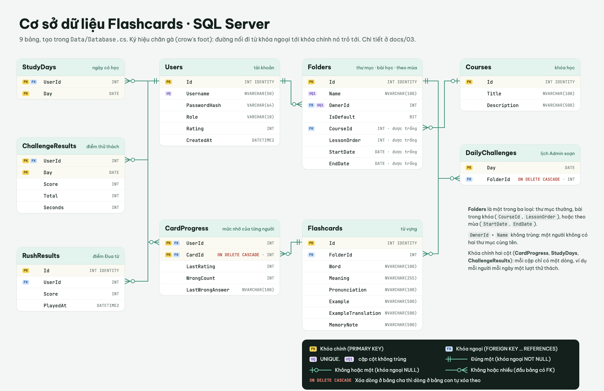

# Database

App dùng **SQL Server Express**. Mỗi máy trong nhóm tự cài SQL Server Express, app tự tạo cơ sở dữ liệu tên `Flashcards` trong đó.

Dùng SQL Server vì app có tài khoản Admin và User: Admin soạn khóa học, thử thách cho mọi User; User thi đua với nhau trên bảng xếp hạng. Nhiều người dùng chung một chỗ dữ liệu là việc SQL Server làm tốt, và môn CSDL ở UIT cũng dạy SQL Server.

Có 9 bảng:

```
Users ─┬─ có nhiều ─ Folders ─── có nhiều ─ Flashcards
       │               │  (thư mục của Admin có thể là
       │               │   một bài trong Courses, hoặc
       │               │   thư mục theo mùa)
       │             Courses
       │
       ├─ có nhiều ─ CardProgress   (mức nhớ của từng người với từng từ)
       ├─ có nhiều ─ StudyDays      (ngày nào có học, để tính chuỗi ngày)
       ├─ có nhiều ─ ChallengeResults (điểm thử thách hằng ngày)
       └─ có nhiều ─ RushResults    (điểm Đua từ)

DailyChallenges: lịch thử thách Admin soạn, mỗi ngày trỏ tới một thư mục
```



## Bảng Users (tài khoản)

| Cột | Kiểu | Chứa gì |
|---|---|---|
| `Id` | INT, máy tự đánh | |
| `Username` | NVARCHAR(50), không trùng | Tên đăng nhập. SQL Server so không phân biệt hoa thường nên "Lan" trùng "lan" |
| `PasswordHash` | VARCHAR(64) | Mật khẩu đã mã hóa SHA-256 của "tên viết thường:mật khẩu", 64 chữ hoa và số. Không bao giờ lưu mật khẩu thật |
| `Role` | VARCHAR(10) | `'Admin'` hoặc `'User'`. Đăng ký trong app luôn là User |
| `Rating` | INT, mặc định 0 | Điểm trình độ (#46, tùy chọn). 0 là chưa có |
| `CreatedAt` | DATETIME2, mặc định giờ tạo | |

Đặt lại mật khẩu (#44) thì `PasswordHash` về mã của "123456".

## Bảng Courses (khóa học)

| Cột | Kiểu | Chứa gì |
|---|---|---|
| `Id` | INT, máy tự đánh | |
| `Title` | NVARCHAR(100) | Tên khóa |
| `Description` | NVARCHAR(500), mặc định `''` | Mô tả |

Khóa học không chứa từ trực tiếp. Mỗi bài là một thư mục của Admin có `CourseId` và `LessonOrder` (xem bảng Folders).

## Bảng Folders (thư mục)

| Cột | Kiểu | Chứa gì |
|---|---|---|
| `Id` | INT, máy tự đánh | |
| `Name` | NVARCHAR(100) | Tên thư mục. Một người không có hai thư mục trùng tên |
| `OwnerId` | INT, trỏ tới `Users.Id` | Ai tạo thư mục |
| `IsDefault` | BIT, mặc định 0 | 1 là "Chưa phân loại" của người đó: không đổi tên, không xóa |
| `CourseId` | INT, được để trống, trỏ tới `Courses.Id` | Có số thì thư mục này là một bài trong khóa |
| `LessonOrder` | INT, được để trống | Bài số mấy trong khóa: 1, 2, 3... |
| `StartDate`, `EndDate` | DATE, được để trống | Thư mục theo mùa (#43): User thấy từ ngày đầu tới hết ngày cuối |

Một thư mục chỉ là một trong ba loại: thư mục thường, bài trong khóa, hoặc theo mùa. Gắn vào khóa thì xóa ngày; đặt ngày thì gỡ khỏi khóa (`CourseStore.AddLesson`, `FolderStore.SetSeason`).

**Ai thấy thư mục nào:**

| Người xem | Thấy |
|---|---|
| User | Thư mục của mình, bài trong khóa đã mở (`CourseStore.GetUnlockedFolderIds`), thư mục theo mùa đang diễn ra |
| Admin | Mọi thư mục của Admin, kể cả bài còn khóa với User |

Thư mục do Admin tạo mà chưa gắn vào khóa, chưa đặt ngày thì User không thấy. Admin dùng chỗ đó để soạn bài trước.

## Bảng Flashcards (từ vựng)

| Cột | Kiểu | Chứa gì | Ví dụ |
|---|---|---|---|
| `Id` | INT, máy tự đánh | | 15 |
| `FolderId` | INT, trỏ tới `Folders.Id` | Nằm trong thư mục nào | 2 |
| `Word` | NVARCHAR(100) | Từ tiếng Anh, bắt buộc | curious |
| `Meaning` | NVARCHAR(255) | Nghĩa tiếng Việt, bắt buộc | tò mò |
| `Pronunciation` | NVARCHAR(100), mặc định `''` | Phiên âm | /ˈkjʊəriəs/ |
| `Example`, `ExampleTranslation`, `MemoryNote` | NVARCHAR(500), mặc định `''` | Câu ví dụ, câu dịch, mẹo nhớ | |

Người sở hữu từ là người sở hữu thư mục. Mức nhớ của từng người nằm ở `CardProgress`.

## Bảng CardProgress (mức nhớ của từng người)

| Cột | Kiểu | Chứa gì |
|---|---|---|
| `UserId` | INT, trỏ tới `Users.Id` | Ai học |
| `CardId` | INT, trỏ tới `Flashcards.Id` | Học từ nào. Xóa từ thì dòng này tự xóa theo |
| `LastRating` | INT | 1 Quên · 2 Khó · 3 Nhớ · 4 Dễ |
| `WrongCount` | INT, mặc định 0 | Đã sai mấy lần |
| `LastWrongAnswer` | NVARCHAR(100), mặc định `''` | Chữ gõ sai lần gần nhất |

Mỗi cặp (`UserId`, `CardId`) chỉ có một dòng. Chưa có dòng nghĩa là chưa học (mức nhớ 0). **Sổ lỗi** là các từ có `LastRating` 1 hoặc 2 của người đang đăng nhập. **Đã nhớ** là `LastRating` từ 3 trở lên.

## Bảng StudyDays (ngày có học)

| Cột | Kiểu | Chứa gì |
|---|---|---|
| `UserId` | INT | |
| `Day` | DATE | Một ngày có học, thử thách hoặc đua từ |

Mỗi người mỗi ngày một dòng. `ActivityStore.MarkToday()` thêm dòng hôm nay nếu chưa có; `StudyStore.SaveResult`, `ChallengeStore.UpdateScore`, `RushStore.Save` gọi hàm này.

## Bảng DailyChallenges (lịch thử thách do Admin soạn)

| Cột | Kiểu | Chứa gì |
|---|---|---|
| `Day` | DATE, không trùng | Ngày |
| `FolderId` | INT, trỏ tới `Folders.Id` | Lấy 10 từ từ thư mục này |

Ngày không có dòng là "Tự chọn": app lấy từ mọi bài trong khóa học và thư mục theo mùa đang diễn ra. Admin chọn lại "Tự chọn" thì xóa dòng của ngày đó.

## Bảng ChallengeResults (điểm thử thách)

| Cột | Kiểu | Chứa gì |
|---|---|---|
| `UserId` | INT | |
| `Day` | DATE | |
| `Score` | INT | Số từ đúng |
| `Total` | INT | Số từ của thử thách, thường là 10 |
| `Seconds` | INT | Thời gian làm |

Mỗi người mỗi ngày một dòng, nên mỗi người chỉ có một lượt. Bấm Bắt đầu thì tạo dòng điểm 0; sau mỗi từ thì cập nhật, thoát giữa chừng vẫn giữ điểm lúc thoát. Xếp hạng: điểm cao đứng trên, bằng điểm thì ít giây hơn đứng trên, chỉ tính tài khoản User.

## Bảng RushResults (điểm Đua từ)

| Cột | Kiểu | Chứa gì |
|---|---|---|
| `Id` | INT, máy tự đánh | |
| `UserId` | INT | |
| `Score` | INT | Số từ gõ đúng trong một lượt |
| `PlayedAt` | DATETIME2, mặc định giờ chơi | |

Chơi bao nhiêu lượt cũng được, mỗi lượt một dòng. Kỷ lục là `MAX(Score)`. Đua từ không ghi vào sổ lỗi.

## Lớp `Flashcard` (`Data/Flashcard.cs`)

Ba cột mức nhớ vẫn là thuộc tính của lớp, nhưng đọc từ `CardProgress` của người đang đăng nhập. Bỏ `NextReviewAt` và `CommonMistake`; `IsLearned`, `Category` tính sẵn, không lưu. Code cũ đang gán `IsLearned`, `Category`, `NextReviewAt` trong `MainWindow.cs` và `AddCardDialog.cs`: xóa các dòng đó cùng lúc đổi lớp, nếu không app không build được.

```csharp
public sealed class Flashcard
{
    public int Id { get; set; }
    public int FolderId { get; set; }
    public string Word { get; set; } = "";
    public string Meaning { get; set; } = "";
    public string Pronunciation { get; set; } = "";
    public string Example { get; set; } = "";
    public string ExampleTranslation { get; set; } = "";
    public string MemoryNote { get; set; } = "";

    // Đọc từ CardProgress của người đang đăng nhập; chưa học thì 0, 0, ""
    public int LastRating { get; set; }
    public int WrongCount { get; set; }
    public string LastWrongAnswer { get; set; } = "";

    public bool IsLearned => LastRating >= 3;
    public string Category => Word.Contains(' ') ? "CỤM TỪ" : "TỪ VỰNG";
}
```

Ô nhập trong `AddCardDialog` đặt `MaxLength` bằng độ dài cột: Từ 100, Nghĩa 255, Phiên âm 100, Câu ví dụ, Câu dịch, Mẹo nhớ 500. SQL Server báo lỗi khi chữ dài hơn cột, nên chặn từ ô nhập cho dễ hiểu.

## Cài đặt trên mỗi máy

1. Cài **SQL Server 2022 Express** (miễn phí). Chọn kiểu cài **Basic**. Tên máy chủ mặc định là `.\SQLEXPRESS`.
2. Cài **SQL Server Management Studio** (SSMS) để mở dữ liệu ra xem.
3. Bấm F5. Lần đầu app tự tạo cơ sở dữ liệu `Flashcards`, 9 bảng và dữ liệu mẫu.

Muốn làm lại từ đầu: mở SSMS, chuột phải `Flashcards` → **Delete**, tick **Close existing connections** → OK, rồi bấm F5.

## Tạo bảng và dữ liệu mẫu (`Data/Database.cs`)

Câu lệnh tạo bảng và dữ liệu mẫu vẫn viết thẳng trong `Data/Database.cs`, không có file `.sql` riêng. `EnsureCreated` nối vào `master` (cơ sở dữ liệu có sẵn của SQL Server), chưa có `Flashcards` thì tạo.

```csharp
using Microsoft.Data.SqlClient;

public static class Database
{
    // Máy nào đặt tên khác .\SQLEXPRESS thì sửa ở đây, nhưng đừng commit dòng đã sửa
    const string Server = @".\SQLEXPRESS";

    // Mọi lớp ...Store mở kết nối bằng chuỗi này
    public static string ConnectionString =>
        $"Server={Server};Database=Flashcards;Trusted_Connection=True;TrustServerCertificate=True";

    static string MasterConnectionString =>
        $"Server={Server};Database=master;Trusted_Connection=True;TrustServerCertificate=True";

    // Gọi một lần trong Program.cs, trước khi mở hộp đăng nhập
    public static void EnsureCreated()
    {
        using (var master = new SqlConnection(MasterConnectionString))
        {
            master.Open();
            using var check = new SqlCommand("SELECT DB_ID('Flashcards')", master);
            if (check.ExecuteScalar() is not DBNull) return; // đã có thì thôi
            using var create = new SqlCommand("CREATE DATABASE Flashcards", master);
            create.ExecuteNonQuery();
        }

        using var conn = new SqlConnection(ConnectionString);
        conn.Open();
        using var cmd = new SqlCommand(CreateTablesSql + SampleDataSql, conn);
        cmd.ExecuteNonQuery();
    }

    const string CreateTablesSql = """
        CREATE TABLE Users (
            Id           INT IDENTITY PRIMARY KEY,           -- máy tự đánh số
            Username     NVARCHAR(50)  NOT NULL UNIQUE,
            PasswordHash VARCHAR(64)   NOT NULL,
            Role         VARCHAR(10)   NOT NULL DEFAULT 'User' CHECK (Role IN ('Admin', 'User')),
            Rating       INT           NOT NULL DEFAULT 0,
            CreatedAt    DATETIME2     NOT NULL DEFAULT SYSDATETIME()
        );

        CREATE TABLE Courses (
            Id          INT IDENTITY PRIMARY KEY,
            Title       NVARCHAR(100) NOT NULL,
            Description NVARCHAR(500) NOT NULL DEFAULT ''
        );

        CREATE TABLE Folders (
            Id          INT IDENTITY PRIMARY KEY,
            Name        NVARCHAR(100) NOT NULL,
            OwnerId     INT NOT NULL REFERENCES Users(Id),
            IsDefault   BIT NOT NULL DEFAULT 0,
            CourseId    INT NULL REFERENCES Courses(Id),
            LessonOrder INT NULL,
            StartDate   DATE NULL,
            EndDate     DATE NULL,
            UNIQUE (OwnerId, Name)                            -- một người không có 2 thư mục trùng tên
        );

        CREATE TABLE Flashcards (
            Id                 INT IDENTITY PRIMARY KEY,
            FolderId           INT NOT NULL REFERENCES Folders(Id),
            Word               NVARCHAR(100) NOT NULL,
            Meaning            NVARCHAR(255) NOT NULL,
            Pronunciation      NVARCHAR(100) NOT NULL DEFAULT '',
            Example            NVARCHAR(500) NOT NULL DEFAULT '',
            ExampleTranslation NVARCHAR(500) NOT NULL DEFAULT '',
            MemoryNote         NVARCHAR(500) NOT NULL DEFAULT ''
        );

        CREATE TABLE CardProgress (
            UserId          INT NOT NULL REFERENCES Users(Id),
            CardId          INT NOT NULL REFERENCES Flashcards(Id) ON DELETE CASCADE, -- xóa từ thì xóa luôn mức nhớ
            LastRating      INT NOT NULL,
            WrongCount      INT NOT NULL DEFAULT 0,
            LastWrongAnswer NVARCHAR(100) NOT NULL DEFAULT '',
            PRIMARY KEY (UserId, CardId)
        );

        CREATE TABLE StudyDays (
            UserId INT  NOT NULL REFERENCES Users(Id),
            Day    DATE NOT NULL,
            PRIMARY KEY (UserId, Day)
        );

        CREATE TABLE DailyChallenges (
            Day      DATE PRIMARY KEY,
            FolderId INT NOT NULL REFERENCES Folders(Id) ON DELETE CASCADE
        );

        CREATE TABLE ChallengeResults (
            UserId  INT  NOT NULL REFERENCES Users(Id),
            Day     DATE NOT NULL,
            Score   INT  NOT NULL DEFAULT 0,
            Total   INT  NOT NULL,
            Seconds INT  NOT NULL DEFAULT 0,
            PRIMARY KEY (UserId, Day)                         -- mỗi người mỗi ngày một lượt
        );

        CREATE TABLE RushResults (
            Id       INT IDENTITY PRIMARY KEY,
            UserId   INT NOT NULL REFERENCES Users(Id),
            Score    INT NOT NULL,
            PlayedAt DATETIME2 NOT NULL DEFAULT SYSDATETIME()
        );
        """;

    // 3 tài khoản mẫu, mật khẩu đều là 123456:
    //   Id 1 admin (Admin), Id 2 lan (User), Id 3 minh (User)
    // Mã hóa bằng HASHBYTES cho khớp với UserStore.HashPassword
    const string SampleDataSql = """
        INSERT INTO Users (Username, PasswordHash, Role) VALUES
            ('admin', CONVERT(VARCHAR(64), HASHBYTES('SHA2_256', 'admin:123456'), 2), 'Admin'),
            ('lan',   CONVERT(VARCHAR(64), HASHBYTES('SHA2_256', 'lan:123456'),   2), 'User'),
            ('minh',  CONVERT(VARCHAR(64), HASHBYTES('SHA2_256', 'minh:123456'),  2), 'User');

        -- Mỗi người một thư mục "Chưa phân loại"
        INSERT INTO Folders (Name, OwnerId, IsDefault) VALUES
            (N'Chưa phân loại', 1, 1), (N'Chưa phân loại', 2, 1), (N'Chưa phân loại', 3, 1);

        -- Khóa học mẫu: 3 bài là 3 thư mục của admin (Id 4, 5, 6)
        INSERT INTO Courses (Title, Description) VALUES (N'Tiếng Anh giao tiếp', N'Từ vựng hằng ngày');
        INSERT INTO Folders (Name, OwnerId, CourseId, LessonOrder) VALUES
            (N'Bài 1 · Daily life', 1, 1, 1),
            (N'Bài 2 · At work',    1, 1, 2),
            (N'Bài 3 · Travel',     1, 1, 3);

        INSERT INTO Flashcards (FolderId, Word, Meaning, Pronunciation, Example, ExampleTranslation) VALUES
            (4, N'curious', N'tò mò', N'/ˈkjʊəriəs/', N'She is curious about everything.', N'Cô ấy tò mò về mọi thứ.'),
            (4, N'commute', N'đi làm hằng ngày', N'/kəˈmjuːt/', N'', N'');
            -- ... thêm cho đủ 30 từ, mỗi bài 10 từ
        """;
}
```

Gọi trong `Program.cs`:

```csharp
Database.EnsureCreated();
// rồi mở LoginDialog (#36); đăng nhập đúng mới Application.Run(new MainWindow())
```

Ghi nhớ khi viết dữ liệu mẫu và câu SQL:

- Chữ có dấu phải có `N` đứng trước: `N'tò mò'`. Quên `N` thì lưu thành "t? m?". Truyền bằng `@tham số` từ C# thì không cần.
- Chữ có dấu nháy gõ 2 lần: `N'don''t'`.
- Cột để trống lưu `''`, không lưu `NULL` (trừ các cột ghi "được để trống" ở trên), nên đọc chỉ cần `reader.GetString(...)`.
- Lấy `Id` vừa tạo: thêm `; SELECT SCOPE_IDENTITY();` sau câu `INSERT` rồi gọi `ExecuteScalar()`.
- Ngày hôm nay trong SQL: `CAST(GETDATE() AS DATE)`.
- Sửa dữ liệu mẫu xong thì xóa cơ sở dữ liệu `Flashcards` trong SSMS rồi bấm F5.

## Học xong một thẻ thì ghi gì (`StudyStore.SaveResult`)

Ghi vào dòng `CardProgress` của (người đang đăng nhập, từ đó). Chưa có dòng thì thêm, có rồi thì sửa.

| Người học | `LastRating` | `WrongCount` | `LastWrongAnswer` |
|---|---|---|---|
| Chọn Quên / Khó | 1 / 2 | cộng 1 | giữ nguyên |
| Gõ sai (Gõ đáp án, Thử thách) | 1 | cộng 1 | chữ vừa gõ |
| Chọn Nhớ / Dễ, hoặc gõ đúng | 3 / 4 | giữ nguyên | để trống |

```csharp
const string sql = """
    IF EXISTS (SELECT 1 FROM CardProgress WHERE UserId = @userId AND CardId = @cardId)
        UPDATE CardProgress
        SET LastRating = @rating,
            WrongCount = WrongCount + CASE WHEN @rating <= 2 THEN 1 ELSE 0 END,
            LastWrongAnswer = CASE WHEN @rating >= 3 THEN '' ELSE ISNULL(@typed, LastWrongAnswer) END
        WHERE UserId = @userId AND CardId = @cardId
    ELSE
        INSERT INTO CardProgress (UserId, CardId, LastRating, WrongCount, LastWrongAnswer)
        VALUES (@userId, @cardId, @rating, CASE WHEN @rating <= 2 THEN 1 ELSE 0 END, ISNULL(@typed, ''))
    """;
// @typed: truyền DBNull.Value khi typedAnswer là null
```

Ghi xong gọi `ActivityStore.MarkToday()`.

## Đọc từ kèm mức nhớ (ví dụ `FlashcardStore.GetByFolder`)

Từ nằm ở `Flashcards`, mức nhớ nằm ở `CardProgress`. Dùng `LEFT JOIN` để từ chưa học vẫn hiện, với mức nhớ 0:

```csharp
public static List<Flashcard> GetByFolder(int folderId)
{
    var cards = new List<Flashcard>();
    using var conn = new SqlConnection(Database.ConnectionString);
    using var cmd = new SqlCommand("""
        SELECT f.Id, f.FolderId, f.Word, f.Meaning, f.Pronunciation, f.Example, f.ExampleTranslation, f.MemoryNote,
               ISNULL(p.LastRating, 0), ISNULL(p.WrongCount, 0), ISNULL(p.LastWrongAnswer, '')
        FROM Flashcards f
        LEFT JOIN CardProgress p ON p.CardId = f.Id AND p.UserId = @userId
        WHERE f.FolderId = @folderId
        """, conn);
    cmd.Parameters.AddWithValue("@userId", Session.CurrentUser!.Id);
    cmd.Parameters.AddWithValue("@folderId", folderId);
    conn.Open();
    using var reader = cmd.ExecuteReader();
    while (reader.Read())
    {
        cards.Add(new Flashcard
        {
            Id = reader.GetInt32(0),
            FolderId = reader.GetInt32(1),
            Word = reader.GetString(2),
            Meaning = reader.GetString(3),
            Pronunciation = reader.GetString(4),
            Example = reader.GetString(5),
            ExampleTranslation = reader.GetString(6),
            MemoryNote = reader.GetString(7),
            LastRating = reader.GetInt32(8),
            WrongCount = reader.GetInt32(9),
            LastWrongAnswer = reader.GetString(10)
        });
    }
    return cards;
}
```

`GetAll` giống vậy, đổi `WHERE` thành các thư mục người đó được thấy (xem "Ai thấy thư mục nào"). Sổ lỗi (`StudyStore.GetMistakes`) dùng `JOIN` thường thay cho `LEFT JOIN`, thêm `WHERE p.LastRating IN (1, 2) ORDER BY p.WrongCount DESC`.

## Đếm từ đã nhớ của mỗi bài (`CourseStore.GetLessons`)

```sql
SELECT d.Id, d.Name, d.LessonOrder,
       COUNT(f.Id)                                         AS WordCount,
       COUNT(CASE WHEN p.LastRating >= 3 THEN 1 END)       AS LearnedCount
FROM Folders d
LEFT JOIN Flashcards f   ON f.FolderId = d.Id
LEFT JOIN CardProgress p ON p.CardId = f.Id AND p.UserId = @userId
WHERE d.CourseId = @courseId
GROUP BY d.Id, d.Name, d.LessonOrder
ORDER BY d.LessonOrder
```

Bài 1 luôn mở. Bài sau mở khi bài trước đã nhớ từ 80% số từ trở lên (`Lesson.IsDone`). Admin thấy mọi bài đều mở.

## Chuỗi ngày học (`ActivityStore.GetStreak`)

Đọc các ngày có học, mới nhất trước, đếm lùi tới ngày đầu tiên bị hụt. Hôm nay chưa học thì bắt đầu đếm từ hôm qua, để sáng ra chuỗi chưa bị về 0.

```csharp
// days: SELECT Day FROM StudyDays WHERE UserId = @userId ORDER BY Day DESC
var expected = DateTime.Today;
if (days.Count > 0 && days[0] < expected) expected = expected.AddDays(-1);
int streak = 0;
foreach (var day in days)
{
    if (day != expected) break;
    streak++;
    expected = expected.AddDays(-1);
}
return streak;
```

## Viết câu SQL bằng `SqlClient`

Mọi lớp `...Store` dùng `SqlConnection` và `SqlCommand` trong gói `Microsoft.Data.SqlClient` (`using Microsoft.Data.SqlClient;`). Gói đã khai báo sẵn trong `FlashcardsApp.csproj`, Visual Studio tự tải khi build. Giữ các quy ước ở [02 – Quy ước code](02-quy-uoc-code.md): dùng `@tham số`, luôn `using var`.

Tham số có thể là `null` (ví dụ `folderId` của `ChallengeStore.SetFolder`) thì truyền `(object?)folderId ?? DBNull.Value`.

SQL Server so chữ không phân biệt hoa thường, nên `FlashcardStore.Exists` và `UserStore.UsernameExists` so thẳng trong câu SQL được: "Tò mò" trùng "tò mò".
