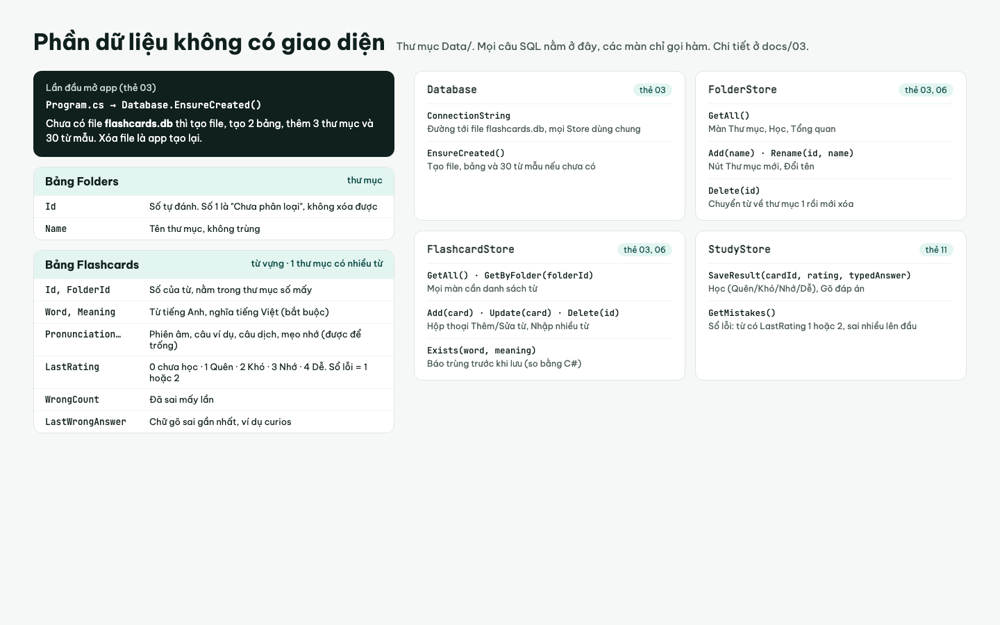

# Database

App dùng **SQLite**: toàn bộ dữ liệu nằm trong một file `flashcards.db` cạnh file chạy của app.

**Lý do không dùng SQL Server:** Dù trong chương trình dạy của UIT sử dụng SQL Server cho môn CSDL nhưng app chỉ một người dùng, không có đăng nhập, không chia sẻ dữ liệu giữa các người dùng. SQL Server sinh ra cho nhiều người cùng truy cập một máy chủ
Lần đầu mở app, nếu chưa có file `flashcards.db` thì app tự tạo file, tạo bảng và thêm 30 từ mẫu. Muốn làm lại từ đầu thì tắt app, xóa file đó, mở lại app.

Chỉ có 2 bảng, như 2 sheet Excel:

```
Folders  (1 thư mục) ───── có nhiều ───── Flashcards (nhiều từ)
```



## Bảng Folders (thư mục)

| Cột | Chứa gì |
|---|---|
| `Id` | Số thứ tự, máy tự đánh. Thư mục số 1 là "Chưa phân loại", không xóa được |
| `Name` | Tên thư mục, bắt buộc, không trùng |

## Bảng Flashcards (từ vựng)

| Cột | Chứa gì | Ví dụ |
|---|---|---|
| `Id` | Số thứ tự, máy tự đánh | 15 |
| `FolderId` | Nằm trong thư mục số mấy (mặc định 1) | 2 |
| `Word` | Từ tiếng Anh, bắt buộc | curious |
| `Meaning` | Nghĩa tiếng Việt, bắt buộc | tò mò |
| `Pronunciation`, `Example`, `ExampleTranslation`, `MemoryNote` | Phiên âm, câu ví dụ, câu dịch, mẹo nhớ. Được để trống | /ˈkjʊəriəs/ |
| `LastRating` | Mức nhớ: 0 chưa học · 1 Quên · 2 Khó · 3 Nhớ · 4 Dễ | 3 |
| `WrongCount` | Đã sai mấy lần | 2 |
| `LastWrongAnswer` | Chữ gõ sai lần gần nhất | curios |

Tên cột trùng với tên thuộc tính trong lớp `Flashcard`. **Sổ lỗi** = các từ có `LastRating` là 1 hoặc 2. Không cần bảng riêng.

## Lớp `Flashcard` (`Data/Flashcard.cs`)

Sửa từ file có sẵn trong bản chạy thử: thêm `Id`, `FolderId`, `WrongCount`, `LastWrongAnswer`; bỏ `NextReviewAt` (không hẹn lịch ôn) và `CommonMistake` (thay bằng `LastWrongAnswer`). `IsLearned` và `Category` không lưu, tính sẵn để code giao diện cũ vẫn đọc được. Code cũ đang **gán** `IsLearned`, `Category`, `NextReviewAt` trong `MainWindow.cs` và `AddCardDialog.cs`: xóa các dòng gán đó cùng lúc đổi lớp, nếu không app sẽ không build được.

```csharp
public sealed class Flashcard
{
    public int Id { get; set; }
    public int FolderId { get; set; } = 1;
    public string Word { get; set; } = "";
    public string Meaning { get; set; } = "";
    public string Pronunciation { get; set; } = "";
    public string Example { get; set; } = "";
    public string ExampleTranslation { get; set; } = "";
    public string MemoryNote { get; set; } = "";
    public int LastRating { get; set; }
    public int WrongCount { get; set; }
    public string LastWrongAnswer { get; set; } = "";
    public bool IsLearned => LastRating >= 3;
    public string Category => Word.Contains(' ') ? "CỤM TỪ" : "TỪ VỰNG";
}
```

SQLite không tự chặn chữ quá dài, nên ô nhập trong `AddCardDialog` phải đặt `MaxLength` để chặn: Từ 100, Nghĩa 255, Phiên âm 100, Câu ví dụ, Câu dịch, Mẹo nhớ 500.

## Tạo bảng và 30 từ mẫu (`Data/Database.cs`)

Không có file `.sql` riêng, không có thư mục `database/`. Câu lệnh tạo bảng và dữ liệu mẫu viết thẳng trong `Data/Database.cs`. Lần đầu mở app, hàm `EnsureCreated` thấy chưa có file `flashcards.db` thì chạy các câu lệnh này.

Cài gói: chuột phải project → **Manage NuGet Packages** → tìm `Microsoft.Data.Sqlite` → **Install**.

```csharp
using Microsoft.Data.Sqlite;

public static class Database
{
    static readonly string FilePath = Path.Combine(AppContext.BaseDirectory, "flashcards.db");

    // Foreign Keys=True: không cho gán từ vào thư mục không tồn tại
    public static string ConnectionString => $"Data Source={FilePath};Foreign Keys=True";

    // Gọi một lần trong Program.cs, trước Application.Run
    public static void EnsureCreated()
    {
        if (File.Exists(FilePath)) return;
        using var conn = new SqliteConnection(ConnectionString);
        conn.Open();
        using var cmd = conn.CreateCommand();
        cmd.CommandText = CreateTablesSql + SampleDataSql;
        cmd.ExecuteNonQuery();
    }

    // Chuỗi nhiều dòng viết giữa hai dấu """
    const string CreateTablesSql = """
        CREATE TABLE Folders (
            Id    INTEGER PRIMARY KEY AUTOINCREMENT,  -- máy tự đánh số 1, 2, 3...
            Name  TEXT NOT NULL UNIQUE                -- bắt buộc, không trùng
        );

        CREATE TABLE Flashcards (
            Id                  INTEGER PRIMARY KEY AUTOINCREMENT,
            FolderId            INTEGER NOT NULL DEFAULT 1 REFERENCES Folders(Id),
            Word                TEXT NOT NULL,
            Meaning             TEXT NOT NULL,
            Pronunciation       TEXT NOT NULL DEFAULT '',  -- '' = để trống
            Example             TEXT NOT NULL DEFAULT '',
            ExampleTranslation  TEXT NOT NULL DEFAULT '',
            MemoryNote          TEXT NOT NULL DEFAULT '',
            LastRating          INTEGER NOT NULL DEFAULT 0,
            WrongCount          INTEGER NOT NULL DEFAULT 0,
            LastWrongAnswer     TEXT NOT NULL DEFAULT ''
        );

        INSERT INTO Folders (Name) VALUES ('Chưa phân loại');
        """;

    // 3 thư mục và 30 từ mẫu, chép từ file JSON của bản chạy thử
    const string SampleDataSql = """
        INSERT INTO Folders (Name) VALUES ('Thư mục mẫu 1'), ('Thư mục mẫu 2'), ('Thư mục mẫu 3');

        INSERT INTO Flashcards (FolderId, Word, Meaning, Pronunciation, Example, ExampleTranslation) VALUES
            (2, 'curious', 'tò mò', '/ˈkjʊəriəs/', 'She is curious about everything.', 'Cô ấy tò mò về mọi thứ.'),
            (2, 'commute', 'đi làm hằng ngày', '/kəˈmjuːt/', '', '');
            -- ... thêm cho đủ 30 từ
        """;
}
```

Gọi `EnsureCreated` trong `Program.cs`, trước khi mở cửa sổ chính:

```csharp
Database.EnsureCreated();
Application.Run(new MainWindow());
```

Ghi nhớ khi viết dữ liệu mẫu:

- Chữ có dấu nháy trong câu SQL phải gõ 2 lần: `'don''t'`.
- Cột để trống lưu chuỗi rỗng `''` chứ không lưu `NULL`, nên khi đọc chỉ cần `reader.GetString(...)`, không phải kiểm tra `NULL`.
- SQLite giữ đúng chữ có dấu, không cần chữ `N` trước chuỗi như SQL Server.
- Sửa dữ liệu mẫu xong thì xóa file `flashcards.db` rồi bấm F5, app mới tạo lại với dữ liệu mới.

Muốn mở file dữ liệu ra xem thì cài **DB Browser for SQLite** (miễn phí, <https://sqlitebrowser.org/>), chọn **Open Database**, mở `flashcards.db` trong `FlashcardsApp/bin/Debug/net10.0-windows/`. Tắt app trước khi sửa dữ liệu bằng công cụ này.

## Học xong một thẻ thì ghi gì

| Người học | `LastRating` | `WrongCount` | `LastWrongAnswer` |
|---|---|---|---|
| Chọn Quên / Khó | 1 / 2 | cộng 1 | giữ nguyên |
| Gõ sai | 1 | cộng 1 | chữ vừa gõ |
| Chọn Nhớ / Dễ, hoặc gõ đúng | 3 / 4 | giữ nguyên | để trống |

## Đọc dữ liệu (ví dụ `FlashcardStore.GetAll`)

```csharp
public static List<Flashcard> GetAll()
{
    var cards = new List<Flashcard>();
    using var conn = new SqliteConnection(Database.ConnectionString);
    using var cmd = new SqliteCommand(
        "SELECT Id, FolderId, Word, Meaning, Pronunciation, Example, ExampleTranslation, MemoryNote, " +
        "LastRating, WrongCount, LastWrongAnswer FROM Flashcards", conn);
    conn.Open();
    using var reader = cmd.ExecuteReader();
    while (reader.Read())
    {
        cards.Add(new Flashcard
        {
            Id = reader.GetInt32(0),
            FolderId = reader.GetInt32(1),
            Word = reader.GetString(2),
            Meaning = reader.GetString(3),
            Pronunciation = reader.GetString(4),
            Example = reader.GetString(5),
            ExampleTranslation = reader.GetString(6),
            MemoryNote = reader.GetString(7),
            LastRating = reader.GetInt32(8),
            WrongCount = reader.GetInt32(9),
            LastWrongAnswer = reader.GetString(10)
        });
    }
    return cards;
}
```

Ghi dữ liệu (ví dụ `FlashcardStore.Add`) xem ở [02 – Quy ước code](02-quy-uoc-code.md). Ai quen SQL Server thì code gần như giống hệt, chỉ đổi tên lớp: `SqlConnection` → `SqliteConnection`, `SqlCommand` → `SqliteCommand`.

**Lưu ý khi so không phân biệt hoa thường:** SQLite chỉ biết đổi hoa thường với chữ không dấu. `FlashcardStore.Exists` nên so bằng C# (`string.Equals(a, b, StringComparison.CurrentCultureIgnoreCase)`) thay vì so trong câu SQL, để "Tò mò" và "tò mò" được coi là trùng.
