# Concept GUI (có thể thay đổi trong quá trình làm)

Màu dùng chung (đều có sẵn trong `Controls/StudyTheme.cs`): xanh chính `#0F766E`, nền chọn `#E3F5F1`, cam báo lỗi `#C2410C`, nền màn `#F7F9FA`, thẻ trắng bo góc. Thêm cho các màn mới: xanh đậm `#13544E` (dải sự kiện), vàng `#B7791F` trên nền `#FFF7E0` (chuỗi ngày, kỷ lục), xanh dương `#1E3A8A` trên nền `#E3E9FB` (bảng xếp hạng, nhãn TÙY CHỌN).

Màn 0 và 1 đã vẽ lại theo menu mới. Màn 2 đến 6 giữ bố cục cũ, ảnh còn vẽ menu cũ; menu thật như ảnh màn 0. Màn 7 đến 12 là màn mới, code đã có khung trống, tên control trong bảng là tên cần đặt khi kéo thả.

---

## 0. Cửa sổ chính · `MainWindow`

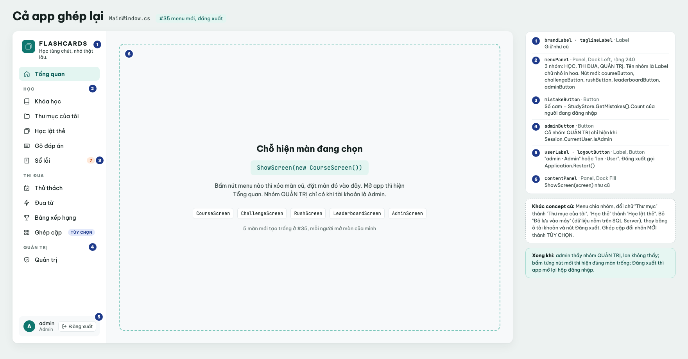

Khung bao quanh mọi màn: cột menu bên trái rộng 240, phần còn lại hiện màn hình con đang chọn. Mở app thì hiện Tổng quan.

| Tên | Loại | Làm gì |
|---|---|---|
| `brandLabel`, `taglineLabel` | Label | "FLASHCARDS" và "Học từng chút, nhớ thật lâu." |
| `menuPanel`, `menuLayout` | Panel Dock Left rộng 240, TableLayoutPanel | Chứa nút menu, chia 3 nhóm. Màn thấp thì cột menu tự có thanh cuộn |
| `learnGroupLabel`, `competeGroupLabel`, `adminGroupLabel` | SpacedLabel | Tên nhóm chữ nhỏ in hoa: HỌC, THI ĐUA, QUẢN TRỊ |
| `overviewButton` | Button | Tổng quan, nằm trên cùng, không thuộc nhóm nào |
| `courseButton`, `folderButton`, `studyButton`, `typeButton`, `mistakeButton` | Button | Nhóm HỌC: Khóa học, Thư mục của tôi, Học lật thẻ, Gõ đáp án, Sổ lỗi |
| `challengeButton`, `rushButton`, `leaderboardButton`, `matchButton` | Button | Nhóm THI ĐUA: Thử thách, Đua từ, Bảng xếp hạng, Ghép cặp (nhãn "TÙY CHỌN") |
| `adminButton` | Button | Nhóm QUẢN TRỊ. Cả nhóm chỉ hiện khi `Session.CurrentUser.IsAdmin` |
| `mistakeButton` | Button | Bên phải có số cam = số từ trong sổ lỗi (`StudyStore.GetMistakes().Count`, #12), đếm lại mỗi lần đổi màn |
| `userPanel`: `avatarBox`, `userLabel`, `logoutButton` | Panel, AvatarBox, Label, Button | Cuối cột menu: chữ cái đầu trong hình tròn, "lan" và dòng dưới "User" hoặc "Admin". Đăng xuất gọi `Application.Restart()` để mở lại hộp đăng nhập |
| `contentPanel` | Panel, Dock Fill | Chỗ hiện màn hình con, đổi bằng `ShowScreen(screen)` |

Mỗi nút đổi màu nền `#E3F5F1`, chữ đậm khi đang chọn. Phím tắt giữ trong `ProcessCmdKey`: đang ở màn Học thì chuyển phím cho `StudyScreen`.
**Khác bản trước:** menu chia nhóm; "Thư mục" đổi thành "Thư mục của tôi", "Học thẻ" thành "Học lật thẻ"; bỏ dòng "Đã lưu vào máy" vì dữ liệu sẽ nằm trên SQL Server, thay bằng ô tài khoản và nút Đăng xuất; nhãn "MỚI" ở Ghép cặp đổi thành "TÙY CHỌN".

**Xong khi:** admin thấy nhóm QUẢN TRỊ, lan không thấy; bấm từng nút menu thì hiện đúng màn; số ở nút Sổ lỗi đúng; Đăng xuất thì app mở lại hộp đăng nhập.

## 1. Tổng quan · `OverviewScreen`

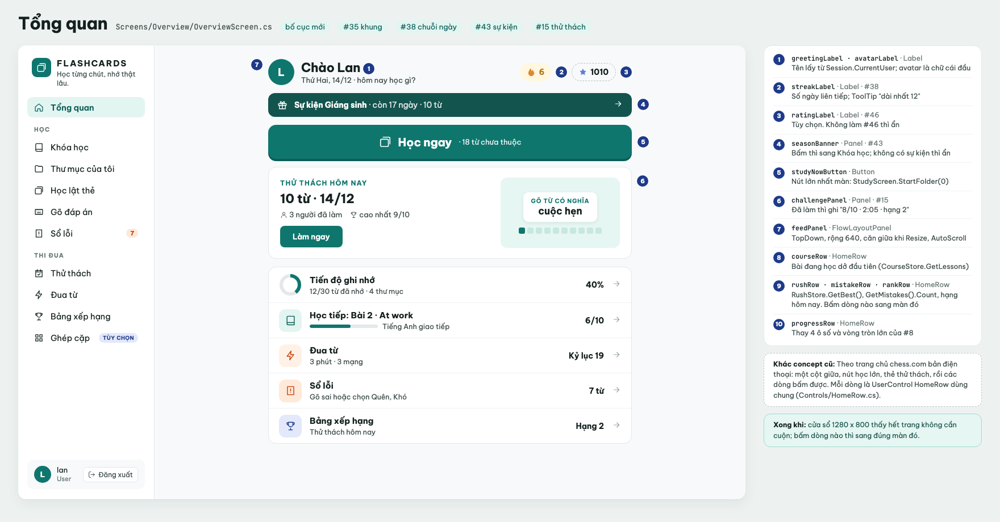

Kiểu trang chủ chess.com bản điện thoại: một cột rộng 640 nằm giữa màn, từ trên xuống là câu chào, dải sự kiện, nút Học ngay thật lớn, thẻ Thử thách hôm nay, rồi các dòng bấm được để sang màn khác.

| Tên | Loại | Làm gì |
|---|---|---|
| `feedPanel` | FlowLayoutPanel | TopDown, rộng 660 (640 + chỗ cho thanh cuộn), AutoScroll. Không neo trái phải nên tự nằm giữa khi đổi cỡ cửa sổ |
| `avatarBox`, `greetingLabel`, `dateLabel` | AvatarBox, Label | Chữ cái đầu của tên, "Chào lan" (tên lấy từ `Session.CurrentUser`), "Thứ Hai, 14/12 · hôm nay học gì?" |
| `streakLabel` | ChipLabel, hình ngọn lửa | Số ngày học liên tiếp (`ActivityStore.GetStreak()`, #38). Rê chuột thấy "6 ngày liên tiếp · dài nhất 12" |
| `ratingLabel` | ChipLabel, hình ngôi sao | Điểm trình độ (#46, tùy chọn). Điểm bằng 0 thì ẩn |
| `seasonBanner`, `seasonLabel` | CardPanel nền `#13544E`, Label | "Sự kiện Giáng sinh · còn 17 ngày · 10 từ" (`FolderStore.GetSeasonal()`, #43). Bấm thì sang Khóa học; không có sự kiện thì ẩn |
| `studyNowButton` | StudyButton cao 60 | Nút lớn nhất màn: "Học ngay · 18 từ chưa thuộc". Mở màn Học với `StartFolder(0)` (tất cả thư mục) |
| `challengePanel` | CardPanel | Thẻ Thử thách hôm nay (#15), gồm `challengeTitleLabel`, `challengeInfoLabel` ("10 từ · 14/12"), `challengeDetailLabel` ("3 người đã làm · cao nhất 9/10"), `challengeButton` ("Làm ngay"). Đã làm thì ghi "8/10 · 2:05 · hạng 2" và nút đổi thành "Xem kết quả" |
| `rowsPanel` | CardPanel | Khung trắng chứa 5 dòng `HomeRow` bên dưới |
| `progressRow` | HomeRow có vòng tròn nhỏ | "Tiến độ ghi nhớ", "12/30 từ đã nhớ · 4 thư mục", bên phải "40%". Bấm thì sang Thư mục |
| `courseRow` | HomeRow | "Học tiếp: Bài 2 · At work", tên khóa, "6/10". Bài đang học dở đầu tiên (`CourseStore.GetLessons`, #39). Bấm thì học bài đó; chưa có bài thì sang Khóa học |
| `rushRow`, `mistakeRow`, `rankRow` | HomeRow | "Kỷ lục 19" (`RushStore.GetBest()`), "7 từ" (sổ lỗi), "Hạng 2" (thử thách hôm nay). Bấm dòng nào sang màn đó |

`HomeRow` là control dùng chung trong `Controls/HomeRow.cs`: hình vuông bo góc có biểu tượng bên trái (`IconName`, `IconColor`, `IconBackColor`), chữ to (`Text`), dòng nhỏ (`Detail`), số bên phải (`Value`), mũi tên. Gán `Percent` từ 0 đến 100 thì thay biểu tượng bằng vòng tròn tiến độ.
Mỗi lần mở màn này thì đọc lại số. Hàm nào trong `Data/` chưa viết thì trả về 0 hoặc danh sách rỗng, dòng đó hiện số 0 hoặc để trống; viết xong hàm thì màn tự có số, không phải sửa màn này.
**Khác bản trước:** bỏ 4 thẻ số, vòng tròn lớn và khung Từ của ngày. Nút Học ngay chuyển từ góc phải xuống giữa, to nhất màn.

**Xong khi:** cửa sổ 1280 x 800 thấy hết trang không cần cuộn; thêm 1 từ rồi quay lại thì số đổi; bấm dòng nào thì sang đúng màn đó.

## 2. Thư mục và từ vựng · `FolderScreen`

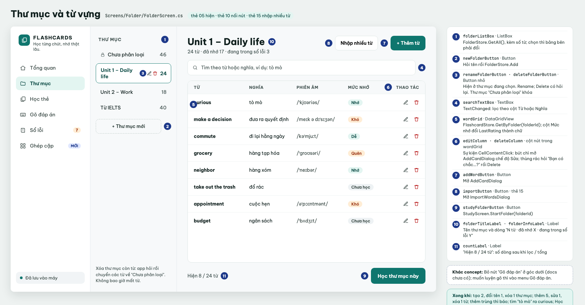

Ba cột: menu chung, cột thư mục (rộng 260), bảng từ. Trên bảng là tên thư mục, dòng "24 từ · đã nhớ 17 · đang trong sổ lỗi 3", nút Nhập nhiều từ và Thêm từ, ô tìm. Dưới bảng là "Hiện 8 / 24 từ" và nút Học thư mục này.

| Tên | Loại | Làm gì |
|---|---|---|
| `folderListBox` | ListBox | Danh sách thư mục kèm số từ; chọn thì bảng bên phải đổi. "Chưa phân loại" có biểu tượng khóa |
| `newFolderButton` | Button | "+ Thư mục mới" dưới danh sách: hỏi tên rồi `FolderStore.Add` |
| `renameFolderButton`, `deleteFolderButton` | Button nhỏ | Bút chì và thùng rác hiện ở thư mục đang chọn. Đổi tên; xóa có hỏi lại. Thư mục số 1 không có hai nút này |
| `folderTitleLabel`, `folderInfoLabel` | Label | Tên thư mục và dòng "N từ · đã nhớ X · đang trong sổ lỗi Y" |
| `importButton` | Button | **Sáng tạo #15:** "Nhập nhiều từ", mở hộp thoại Nhập nhiều từ |
| `addWordButton` | Button | "+ Thêm từ", mở hộp thoại Thêm từ |
| `searchTextBox` | TextBox | Gõ tới đâu lọc tới đó theo cột Từ hoặc Nghĩa (sự kiện TextChanged) |
| `wordGrid` | DataGridView | Cột: Từ, Nghĩa, Phiên âm, Mức nhớ (chữ Chưa học / Quên / Khó / Nhớ / Dễ), Thao tác |
| `editColumn`, `deleteColumn` | Cột nút trong `wordGrid` (DataGridViewButtonColumn) | Cột Thao tác: bút chì mở hộp thoại ở chế độ Sửa, thùng rác hỏi "Bạn có chắc muốn xóa từ này?" rồi xóa. Bắt bằng sự kiện `CellContentClick` |
| `countLabel` | Label | "Hiện 8 / 24 từ" (số dòng sau khi lọc / tổng) |
| `studyFolderButton` | Button | "Học thư mục này": `StudyScreen.StartFolder(folderId)` |

Dưới cột thư mục ghi: *"Xóa thư mục còn từ: app hỏi rồi chuyển các từ về "Chưa phân loại". Không bao giờ mất từ."*
**Không làm:** nút "Gõ đáp án" ở góc dưới (muốn luyện gõ thì vào menu Gõ đáp án).

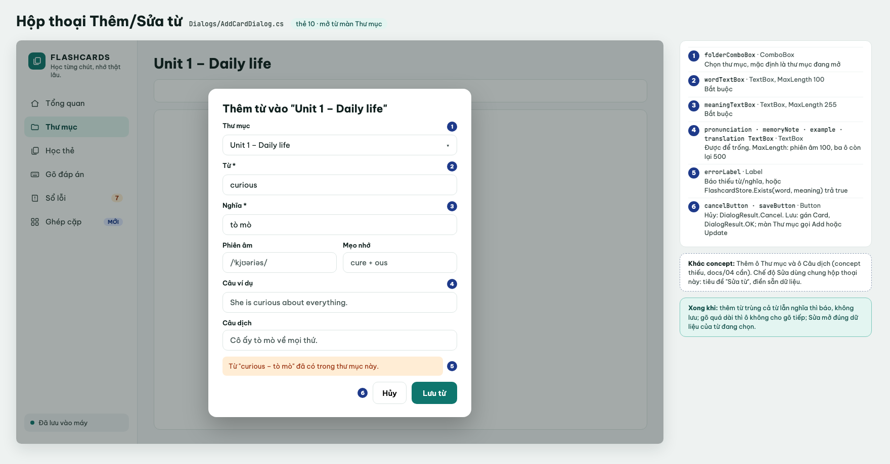

**Hộp thoại Thêm/Sửa từ** (`Dialogs/AddCardDialog`, đã có trong bản chạy thử). Tiêu đề "Thêm từ vào "<tên thư mục>"", chế độ Sửa thì "Sửa từ" và điền sẵn dữ liệu.

| Tên | Loại | Làm gì |
|---|---|---|
| `folderComboBox` | ComboBox | Chọn thư mục, mặc định là thư mục đang mở |
| `wordTextBox`, `meaningTextBox` | TextBox | Bắt buộc. `MaxLength` 100 và 255 |
| `pronunciationTextBox`, `memoryNoteTextBox` | TextBox | Hai ô cạnh nhau: Phiên âm (`MaxLength` 100), Mẹo nhớ (500) |
| `exampleTextBox`, `translationTextBox` | TextBox | Câu ví dụ, Câu dịch (`MaxLength` 500) |
| `errorLabel` | Label | Nền cam nhạt: thiếu từ/nghĩa, hoặc `FlashcardStore.Exists(word, meaning)` trả true: *"Từ "curious – tò mò" đã có trong thư mục này."* |
| `cancelButton`, `saveButton` | Button | Hủy (`DialogResult.Cancel`), Lưu từ (gán `Card`, `DialogResult.OK`; màn Thư mục gọi `Add` hoặc `Update`) |

Bản chạy thử đặt tên ô là `word`, `meaning`…: đổi sang tên trên. `MaxLength` bản chạy thử đang cho 300 và 1000, lưu sẽ lỗi.

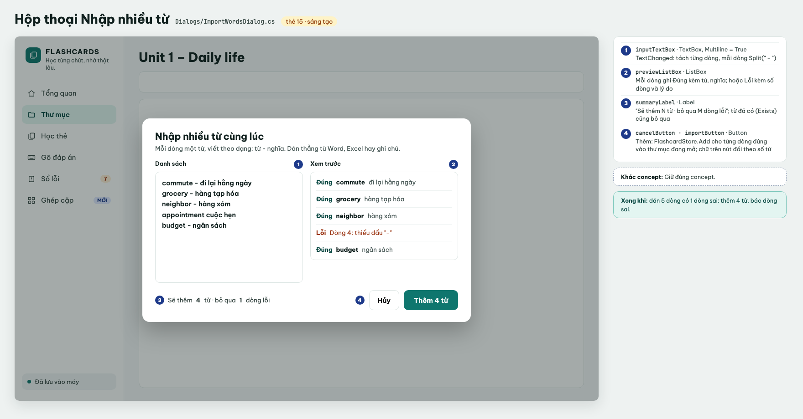

**Hộp thoại Nhập nhiều từ** (`Dialogs/ImportWordsDialog`, sáng tạo #15). Tiêu đề "Nhập nhiều từ cùng lúc", dòng hướng dẫn "Mỗi dòng một từ, viết theo dạng: từ - nghĩa".

| Tên | Loại | Làm gì |
|---|---|---|
| `inputTextBox` | TextBox, Multiline | "Danh sách": dán nhiều dòng; TextChanged thì tách từng dòng bằng `Split(" - ")` |
| `previewListBox` | ListBox | "Xem trước": mỗi dòng ghi **Đúng** kèm từ, nghĩa; hoặc **Lỗi** kèm số dòng và lý do |
| `summaryLabel` | Label | "Sẽ thêm N từ · bỏ qua M dòng lỗi"; từ đã có cũng bỏ qua |
| `cancelButton`, `importButton` | Button | Hủy; "Thêm N từ": `FlashcardStore.Add` từng dòng đúng vào thư mục đang mở |

**Xong khi:** tạo 2 thư mục, đổi tên 1, xóa 1 (từ trong đó về "Chưa phân loại"); thêm 5 từ, sửa 1, xóa 1; thêm trùng thì báo; tìm "tò mò" ra curious; bấm Học thư mục này thì vào đúng thư mục.

## 3. Học lật thẻ · `StudyScreen`

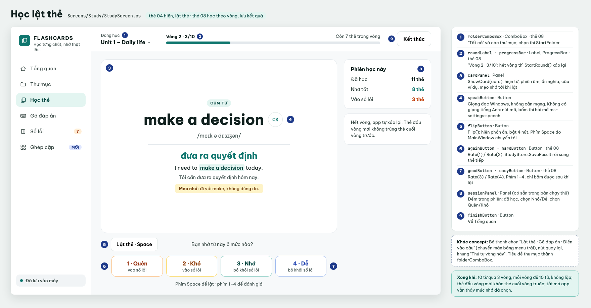

Thanh trên cùng (nền trắng, cao 72): thư mục đang học, tiến độ vòng, nút Kết thúc. Giữa là thẻ lớn, dưới thẻ là nút lật và 4 nút đánh giá. Cột phải rộng 260: "Phiên học này".

| Tên | Loại | Làm gì |
|---|---|---|
| `folderComboBox` | ComboBox | Dưới chữ "Đang học": chọn thư mục hoặc "Tất cả" |
| `roundLabel`, `progressBar` | Label, ProgressBar | "Vòng 2 · 3/10", bên phải "Còn 7 thẻ trong vòng" |
| `finishButton` | Button | "Kết thúc": về Tổng quan |
| `cardPanel` | Panel | Nhãn TỪ VỰNG / CỤM TỪ, từ, phiên âm; dưới gạch là nghĩa, câu ví dụ (từ được tô nền xanh), câu dịch, mẹo nhớ. Phần dưới gạch ẩn tới khi lật |
| `speakButton` | Button tròn cạnh từ | Đọc từ bằng giọng của Windows (đã có trong bản chạy thử), không cần mạng. Máy không có giọng tiếng Anh thì nút mờ, ToolTip "Máy chưa có giọng đọc tiếng Anh"; bấm vào thì hỏi mở cài đặt giọng đọc (`ms-settings:speech`) |
| `flipButton` | Button | "Lật thẻ · Space" |
| `againButton`, `hardButton`, `goodButton`, `easyButton` | Button | "1 · Quên", "2 · Khó" (dòng dưới: vào sổ lỗi), "3 · Nhớ", "4 · Dễ" (bỏ khỏi sổ lỗi). Phím **1–4**. Chỉ bấm được sau khi lật. Bấm thì gọi `StudyStore.SaveResult` rồi sang thẻ tiếp |
| `sessionPanel` | Panel (có sẵn trong bản chạy thử) | "Phiên học này": Đã học, Nhớ tốt (chọn Nhớ/Dễ), Vào sổ lỗi (chọn Quên/Khó) |

Dưới các nút ghi "Phím Space để lật · phím 1–4 để đánh giá". Dưới `sessionPanel` ghi "Hết vòng, app tự xáo lại. Thẻ đầu vòng mới không trùng thẻ cuối vòng trước."
Phím tắt: dùng lại hàm `ProcessCmdKey` có sẵn trong `MainWindow` (Space, 1–4), `MainWindow` chuyển phím cho màn này. Code vẽ và lật thẻ (`RenderCard`, `FitWordLabel`) cũng lấy từ `MainWindow`.
**So với bản chạy thử:** bỏ nút trước/sau (phím ←/→) và chữ hẹn giờ "1 phút / 10 phút / 1 ngày / 4 ngày" trên 4 nút, vì app học theo vòng, không hẹn lịch ôn.
Thư mục trống: báo *"Thư mục này chưa có từ. Hãy thêm từ trước."*
**Không làm:** thanh chọn "Lật thẻ · Gõ đáp án · Điền vào câu" (chuyển màn bằng menu trái), nút quay lại, khung "Thứ tự vòng này".

**Xong khi:** học thư mục 10 từ qua 3 vòng, mỗi vòng đủ 10 từ, không lặp; thẻ đầu vòng mới khác thẻ cuối vòng trước; tắt mở app vẫn thấy kết quả đã chọn.

## 4. Gõ đáp án · `TypeAnswerScreen`

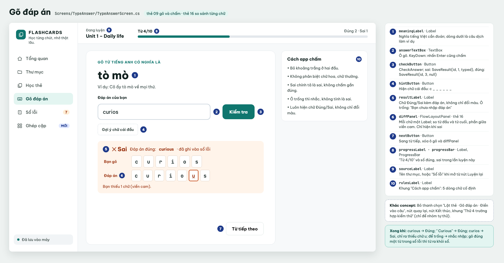

Thanh trên cùng: "Đang luyện" + tên thư mục, tiến độ. Giữa là thẻ lớn để gõ. Cột phải rộng 260: "Cách app chấm".

| Tên | Loại | Làm gì |
|---|---|---|
| `sourceLabel` | Label | "Đang luyện" + tên thư mục, hoặc "Sổ lỗi" khi mở từ nút Luyện lại |
| `progressLabel`, `progressBar` | Label, ProgressBar | "Từ 4/10", bên phải "Đúng 2 · Sai 1" |
| `meaningLabel` | Label | Dưới chữ "GÕ TỪ TIẾNG ANH CÓ NGHĨA LÀ": nghĩa tiếng Việt cần đoán, dòng dưới là câu dịch làm ví dụ |
| `answerTextBox` | TextBox | "Đáp án của bạn". Nhấn **Enter** cũng chấm (sự kiện KeyDown) |
| `checkButton` | Button | "Kiểm tra": chấm đáp án |
| `hintButton` | Button viền đứt | "Gợi ý chữ cái đầu": hiện `c _ _ _ _ _ _` |
| `resultLabel` | Label | Trong khung cam nhạt: **✕ Sai** · "Đáp án đúng: curious · đã ghi vào sổ lỗi"; đúng thì **Đúng** nền xanh. Không chỉ đổi màu |
| `diffPanel` | FlowLayoutPanel | **Sáng tạo #16:** hai hàng ô chữ "Bạn gõ" và "Đáp án"; chữ sai viền cam, dòng dưới "Bạn thiếu 1 chữ (viền cam)." |
| `nextButton` | Button | "Từ tiếp theo" |
| `rulesLabel` | Label | Khung "Cách app chấm": 5 dòng quy tắc chấm (chữ cố định) |

Cách chấm: bỏ khoảng trắng hai đầu, không phân biệt hoa thường. Ô trống: *"Bạn chưa nhập đáp án"*, không tính sai. Sai chính tả là sai. Cách chấm này viết trong hàm `public static bool CheckAnswer(typed, answer)` của màn này, để Thử thách và Đua từ gọi lại, chấm giống hệt.
Màn khác mở màn này với danh sách từ cho trước bằng `Start(List<Flashcard>)` (Sổ lỗi dùng khi bấm Luyện lại).
Sau khi chấm: gõ sai gọi `StudyStore.SaveResult` mức 1 kèm chữ vừa gõ; gõ đúng gọi mức 3 để từ ra khỏi sổ lỗi.
**Không làm:** thanh chọn "Lật thẻ · Gõ đáp án · Điền vào câu", nút quay lại, nút Kết thúc, khung "Thử 4 trường hợp kiểm thử" (chỉ để nhóm tự thử).

**Xong khi:** gõ `curious` → Đúng; ` Curious` → Đúng; `curios` → Sai, chỉ ra thiếu chữ u; để trống → nhắc nhập; gõ đúng một từ trong sổ lỗi thì từ đó ra khỏi sổ.

## 5. Sổ lỗi · `MistakeScreen`

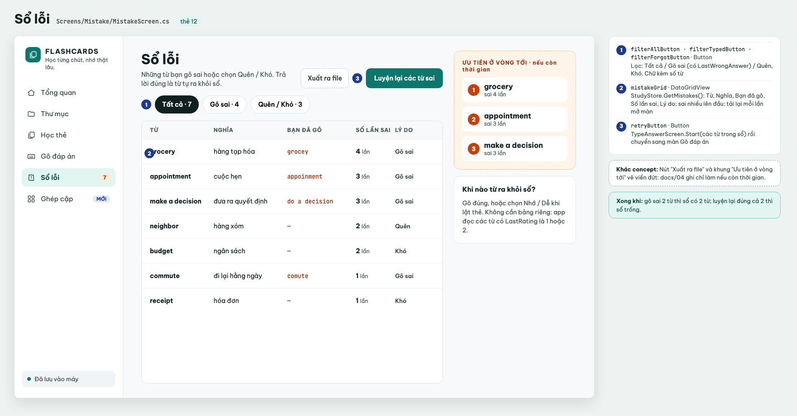

Trên cùng: tiêu đề "Sổ lỗi", dòng "Những từ bạn gõ sai hoặc chọn Quên / Khó. Trả lời đúng là từ tự ra khỏi sổ.", nút Luyện lại. Dưới là các nút lọc dạng viên thuốc và bảng. Cột phải rộng 270.

| Tên | Loại | Làm gì |
|---|---|---|
| `filterAllButton`, `filterTypedButton`, `filterForgotButton` | Button | "Tất cả · 7", "Gõ sai · 4" (có `LastWrongAnswer`), "Quên / Khó · 3". Nút đang chọn nền đậm |
| `mistakeGrid` | DataGridView | Từ, Nghĩa, Bạn đã gõ (chữ cam, "—" nếu không gõ), Số lần sai, Lý do. Sắp theo số lần sai giảm dần |
| `retryButton` | Button | "Luyện lại các từ sai": `TypeAnswerScreen.Start(các từ trong sổ)` rồi chuyển sang màn Gõ đáp án |

Cột phải có khung "Khi nào từ ra khỏi sổ?": gõ đúng, hoặc chọn Nhớ / Dễ khi lật thẻ.
**Nếu còn thời gian:** nút "Xuất ra file" và khung "Ưu tiên ở vòng tới" (3 từ sai nhiều nhất).

**Xong khi:** gõ sai 2 từ thì sổ có 2 từ; luyện lại đúng cả 2 thì sổ trống.

## 6. Ghép cặp · `MatchScreen` (tùy chọn)

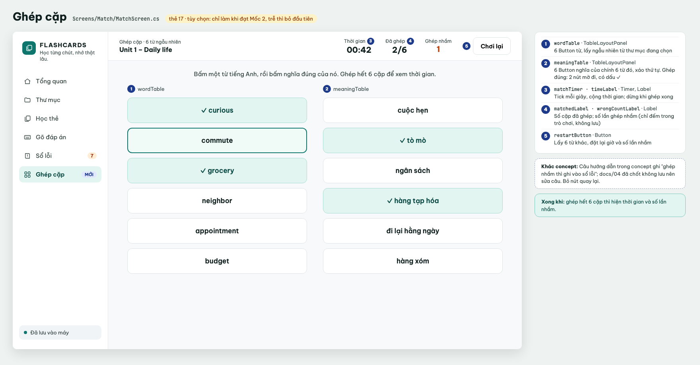

Chỉ làm nếu đạt Mốc 2 (18/11). Thanh trên cùng: "Ghép cặp · 6 từ ngẫu nhiên" + tên thư mục, thời gian, đã ghép, ghép nhầm, nút Chơi lại. Dưới là câu hướng dẫn và 2 cột nút.

| Tên | Loại | Làm gì |
|---|---|---|
| `wordTable`, `meaningTable` | TableLayoutPanel | 6 nút từ bên trái, 6 nút nghĩa bên phải (xáo). Đang chọn: viền xanh đậm; ghép đúng: nền xanh nhạt, dấu ✓, không bấm được nữa |
| `matchTimer`, `timeLabel` | Timer, Label | "Thời gian 00:42", tăng mỗi giây, dừng khi ghép xong |
| `matchedLabel`, `wrongCountLabel` | Label | "Đã ghép 2/6", "Ghép nhầm 1" (chỉ đếm trong trò chơi, không lưu vào file dữ liệu) |
| `restartButton` | Button | "Chơi lại": lấy 6 từ khác, đặt lại giờ và số lần nhầm |

Câu hướng dẫn: *"Bấm một từ tiếng Anh, rồi bấm nghĩa đúng của nó. Ghép hết 6 cặp để xem thời gian."*

**Xong khi:** ghép hết 6 cặp thì hiện thời gian và số lần nhầm.

---

# Màn mới (phạm vi Admin / User)

Các màn dưới đây đã có file trong code, mở ra chỉ thấy dòng "(đang làm, #số issue)". Người làm màn nào thì kéo thả control vào Designer của màn đó theo bảng, rồi viết tiếp các hàm có ghi `TODO (#số issue)`.

## 7. Đăng nhập · `LoginDialog` (#36)

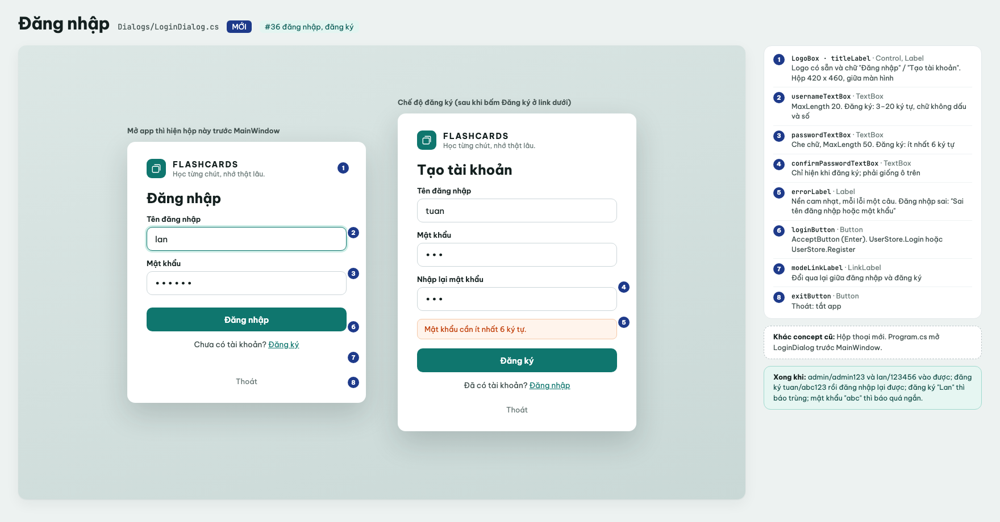

Hộp thoại 420 x 460 giữa màn hình, mở trước `MainWindow` (sửa trong `Program.cs`, đã có chú thích hướng dẫn). Bên trái ảnh là chế độ đăng nhập, bên phải là chế độ đăng ký.

| Tên | Loại | Làm gì |
|---|---|---|
| `LogoBox`, `titleLabel` | Control, Label | Logo có sẵn và chữ "Đăng nhập" hoặc "Tạo tài khoản" |
| `usernameTextBox` | TextBox | `MaxLength` 20. Đăng ký: 3 đến 20 ký tự, chữ không dấu và số |
| `passwordTextBox` | TextBox | Che chữ, `MaxLength` 50. Đăng ký: ít nhất 6 ký tự |
| `confirmPasswordTextBox` | TextBox | Chỉ hiện khi đăng ký, phải giống ô trên |
| `errorLabel` | Label | Nền cam nhạt, mỗi lỗi một câu. Đăng nhập sai: "Sai tên đăng nhập hoặc mật khẩu" |
| `loginButton` | Button | `AcceptButton` (nhấn Enter). Gọi `UserStore.Login` hoặc `UserStore.Register` |
| `modeLinkLabel` | LinkLabel | "Chưa có tài khoản? Đăng ký" / "Đã có tài khoản? Đăng nhập": đổi qua lại hai chế độ |
| `exitButton` | Button | Thoát: tắt app |

Hàm đã có sẵn tên: `SubmitForm`, `GetRegisterError`, `ToggleMode`.

**Xong khi:** admin/admin123 và lan/123456 vào được; đăng ký tuan/abc123 rồi đăng nhập lại được; đăng ký "Lan" thì báo trùng; mật khẩu "abc" thì báo quá ngắn.

## 8. Khóa học · `CourseScreen` (#39, #43)

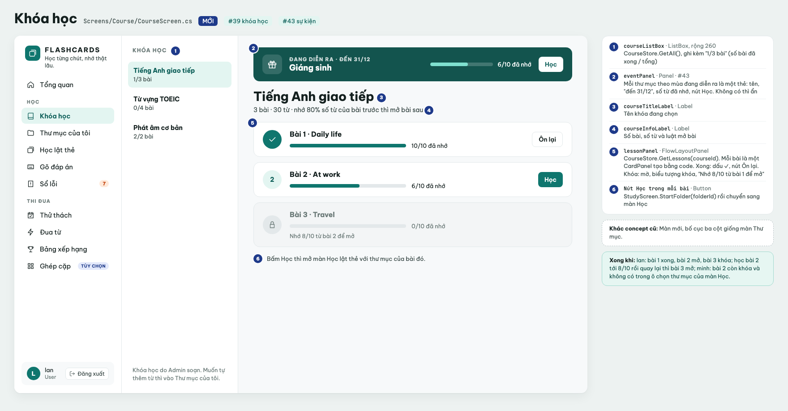

Ba cột giống màn Thư mục: menu chung, cột khóa học (rộng 260), danh sách bài.

| Tên | Loại | Làm gì |
|---|---|---|
| `courseListBox` | ListBox, rộng 260 | `CourseStore.GetAll()`, ghi kèm "1/3 bài" (số bài đã xong / tổng số bài) |
| `eventPanel` | Panel nền `#13544E` | #43: mỗi thư mục theo mùa đang diễn ra là một thẻ: tên, "ĐANG DIỄN RA · ĐẾN 31/12", "6/10 đã nhớ", nút Học. Không có thì ẩn |
| `courseTitleLabel` | Label | Tên khóa đang chọn |
| `courseInfoLabel` | Label | "3 bài · 30 từ · nhớ 80% số từ của bài trước thì mở bài sau" |
| `lessonPanel` | FlowLayoutPanel | `CourseStore.GetLessons(courseId)`. Mỗi bài là một CardPanel tạo bằng code. Bài xong: dấu ✓, nút "Ôn lại". Bài đang mở: số bài, nút "Học". Bài khóa: mờ, biểu tượng khóa, "Nhớ 8/10 từ bài 1 để mở" |
| Nút Học trong mỗi bài | Button | Gọi `StudyLesson(folderId)` (đã viết sẵn): mở màn Học lật thẻ với thư mục của bài đó |

Dưới cột khóa học ghi: "Khóa học do Admin soạn. Muốn tự thêm từ thì vào Thư mục của tôi."

**Xong khi:** lan thấy bài 1 xong, bài 2 mở, bài 3 khóa; học bài 2 tới 8/10 rồi quay lại thì bài 3 mở; minh thấy bài 2 còn khóa và bài đó không có trong ô chọn thư mục của màn Học.

## 9. Thử thách hằng ngày · `ChallengeScreen` (#15)

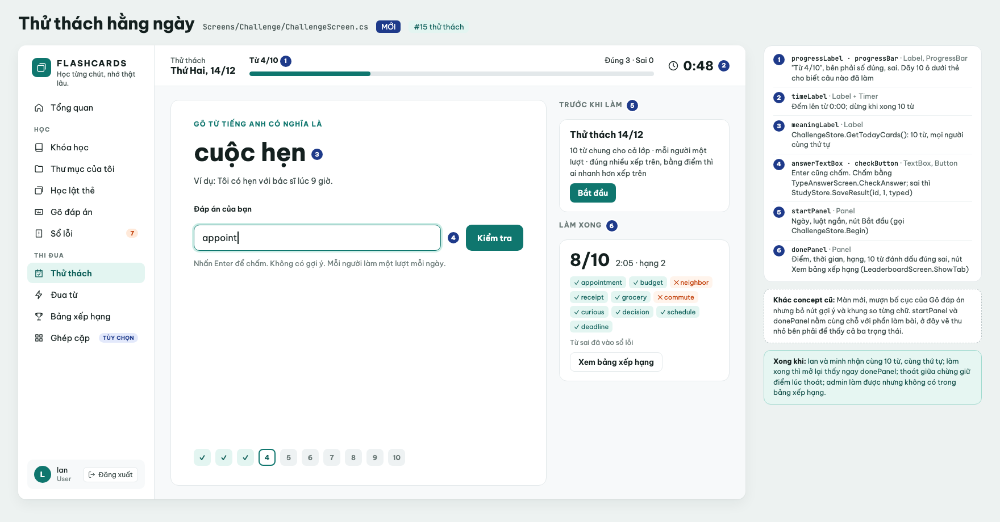

Mượn bố cục màn Gõ đáp án nhưng bỏ nút gợi ý và khung so từng chữ. Màn có ba phần nằm cùng một chỗ, mỗi lúc chỉ hiện một phần: `startPanel` (trước khi làm), phần làm bài, `donePanel` (làm xong). Ảnh vẽ thu nhỏ hai panel ở bên phải để thấy đủ cả ba.

| Tên | Loại | Làm gì |
|---|---|---|
| `progressLabel`, `progressBar` | Label, ProgressBar | "Từ 4/10", bên phải "Đúng 3 · Sai 0". Dãy 10 ô dưới thẻ cho biết câu nào đã làm |
| `timeLabel`, Timer | Label, Timer | Đếm lên từ 0:00, dừng khi xong 10 từ |
| `meaningLabel` | Label | Nghĩa tiếng Việt cần đoán, dòng dưới là câu dịch. Từ lấy bằng `ChallengeStore.GetTodayCards()`: 10 từ, mọi người cùng thứ tự |
| `answerTextBox`, `checkButton` | TextBox, Button | Enter cũng chấm. Chấm bằng `TypeAnswerScreen.CheckAnswer`; sai thì `StudyStore.SaveResult(id, 1, typed)` để từ vào sổ lỗi |
| `startPanel` | Panel | Ngày, luật ngắn ("10 từ chung cho cả lớp · mỗi người một lượt · bằng điểm thì ai nhanh hơn xếp trên"), nút Bắt đầu (gọi `ChallengeStore.Begin`) |
| `donePanel` | Panel | Điểm "8/10", "2:05 · hạng 2", 10 từ đánh dấu đúng sai, "Từ sai đã vào sổ lỗi", nút Xem bảng xếp hạng (đã viết sẵn `OpenLeaderboard`) |

Mỗi lần chấm thì gọi `ChallengeStore.UpdateScore(score, seconds)`, nên thoát giữa chừng vẫn giữ điểm lúc thoát.

**Xong khi:** lan và minh nhận cùng 10 từ, cùng thứ tự; làm xong mở lại thì thấy ngay `donePanel`; thoát giữa chừng giữ điểm lúc thoát; admin làm được nhưng không có trong bảng xếp hạng.

## 10. Đua từ · `RushScreen` (#41)

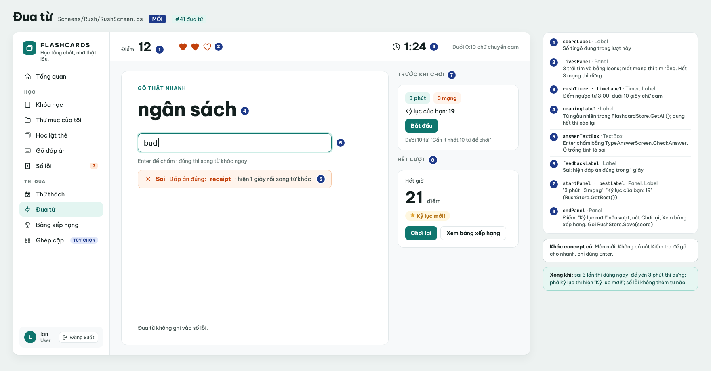

Gõ càng nhiều từ đúng càng tốt trong 3 phút, sai 3 lần thì dừng. Không có nút Kiểm tra, chỉ dùng Enter cho nhanh. Cũng có `startPanel` và `endPanel` nằm cùng chỗ với phần chơi.

| Tên | Loại | Làm gì |
|---|---|---|
| `scoreLabel` | Label | Số từ gõ đúng trong lượt này |
| `livesPanel` | Panel | 3 trái tim vẽ bằng `Icons`; mất một mạng thì một tim rỗng |
| `rushTimer`, `timeLabel` | Timer, Label | Đếm ngược từ 3:00; dưới 10 giây thì chữ chuyển cam |
| `meaningLabel` | Label | Từ ngẫu nhiên trong `FlashcardStore.GetAll()`; dùng hết thì xáo lại |
| `answerTextBox` | TextBox | Enter thì chấm bằng `TypeAnswerScreen.CheckAnswer`. Ô trống tính là sai |
| `feedbackLabel` | Label | Nền cam nhạt: "Sai · Đáp án đúng: receipt", hiện 1 giây rồi sang từ khác |
| `startPanel`, `bestLabel` | Panel, Label | "3 phút · 3 mạng", "Kỷ lục của bạn: 19" (`RushStore.GetBest()`), nút Bắt đầu. Dưới 10 từ thì báo "Cần ít nhất 10 từ để chơi" |
| `endPanel` | Panel | "Hết giờ" hoặc "Hết mạng", điểm, "Kỷ lục mới!" nếu vượt, nút Chơi lại và Xem bảng xếp hạng. Gọi `RushStore.Save(score)` |

Đua từ không ghi vào sổ lỗi.

**Xong khi:** sai 3 lần thì dừng ngay; để yên 3 phút thì dừng; phá kỷ lục thì hiện "Kỷ lục mới!"; sổ lỗi không thêm từ nào.

## 11. Bảng xếp hạng · `LeaderboardScreen` (#45)

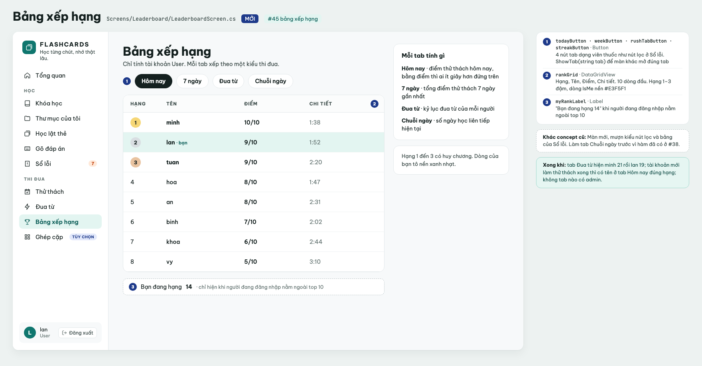

Mượn kiểu nút lọc và bảng của màn Sổ lỗi. Chỉ tính tài khoản User. Cột phải rộng 290 ghi mỗi tab tính gì.

| Tên | Loại | Làm gì |
|---|---|---|
| `todayButton`, `weekButton`, `rushTabButton`, `streakButton` | Button dạng viên thuốc | 4 tab: Hôm nay (điểm thử thách hôm nay, bằng điểm thì ai ít giây hơn đứng trên), 7 ngày (tổng điểm 7 ngày gần nhất), Đua từ (kỷ lục mỗi người), Chuỗi ngày (số ngày học liên tiếp hiện tại) |
| `rankGrid` | DataGridView | Hạng, Tên, Điểm, Chi tiết. 10 dòng đầu. Hạng 1 đến 3 có huy chương và chữ đậm; dòng của mình (`IsMe`) nền `#E3F5F1`, ghi thêm "· bạn" |
| `myRankLabel` | Label | "Bạn đang hạng 14", chỉ hiện khi người đang đăng nhập nằm ngoài top 10 |

Màn khác mở đúng tab bằng `ShowTab(LeaderboardScreen.TodayTab)` (có sẵn 4 hằng `TodayTab`, `WeekTab`, `RushTab`, `StreakTab`). Hàm `ShowTab` đã chọn đúng hàm trong `Data/` cho từng tab, chỉ còn đổ vào `rankGrid`. Nên làm tab Chuỗi ngày trước vì hàm đã có ở #38.

**Xong khi:** tab Đua từ hiện minh 21 rồi lan 19; tài khoản mới làm thử thách xong thì có tên ở tab Hôm nay đúng hạng; không tab nào có admin.

## 12. Quản trị · `AdminScreen` (#40, #42, #43, #44)

Chỉ tài khoản Admin thấy màn này. Trên cùng là tiêu đề "Quản trị" và 4 nút tab: Khóa học, Theo mùa, Thử thách, Người dùng. Bấm tab nào thì `tabContentPanel` hiện UserControl của tab đó (hàm `ShowTab(panel)` đã có). Mỗi tab là một file riêng trong `Screens/Admin/` để mỗi người làm một tab không đụng nhau. #40 làm khung 4 tab và tab Khóa học.

### 12a. Tab Khóa học · `AdminCoursePanel` (#40)

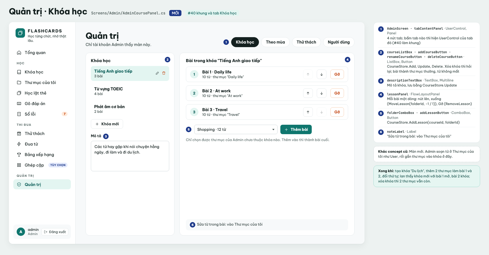

| Tên | Loại | Làm gì |
|---|---|---|
| `courseListBox`, `addCourseButton`, `renameCourseButton`, `deleteCourseButton` | ListBox, Button | `CourseStore.Add`, `Update`, `Delete`. Xóa khóa thì hỏi lại; các bài thành thư mục thường, từ không mất |
| `descriptionTextBox` | TextBox, Multiline | Mô tả khóa, lưu bằng `CourseStore.Update` |
| `lessonPanel` | FlowLayoutPanel | Mỗi bài một dòng: số bài, tên, số từ, nút lên và xuống (`MoveLesson(folderId, -1)` hoặc `1`), nút Gỡ (`RemoveLesson`). Bài đầu mờ nút lên, bài cuối mờ nút xuống |
| `folderComboBox`, `addLessonButton` | ComboBox, Button | Chỉ có thư mục của Admin chưa thuộc khóa nào. `CourseStore.AddLesson(courseId, folderId)`, thêm vào thành bài cuối |
| `noteLabel` | Label | "Sửa từ trong bài: vào Thư mục của tôi" |

Admin soạn từ ở Thư mục của tôi như User, rồi gắn thư mục vào khóa ở đây.

**Xong khi:** tạo khóa "Du lịch", thêm 2 thư mục làm bài 1 và 2, đổi thứ tự; lan thấy khóa mới với bài 1 mở, bài 2 khóa; xóa khóa thì 2 thư mục vẫn còn.

### 12b. Tab Theo mùa · `AdminSeasonPanel` (#43)

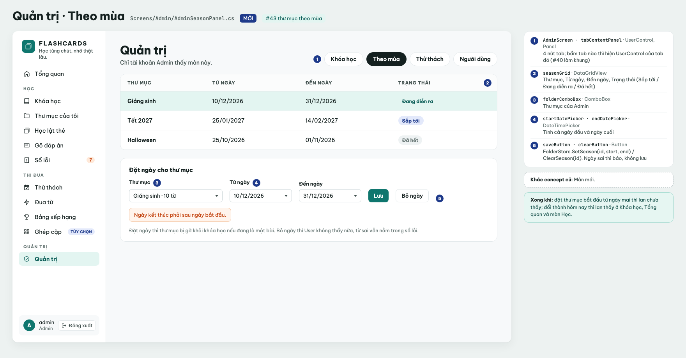

| Tên | Loại | Làm gì |
|---|---|---|
| `seasonGrid` | DataGridView | Thư mục, Từ ngày, Đến ngày, Trạng thái (Sắp tới / Đang diễn ra / Đã hết, tính bằng `GetStatus` đã viết sẵn) |
| `folderComboBox` | ComboBox | Thư mục của Admin (`FolderStore.GetMine()`) |
| `startDatePicker`, `endDatePicker` | DateTimePicker | Tính cả ngày đầu và ngày cuối |
| `saveButton`, `clearButton` | Button | `FolderStore.SetSeason(id, start, end)` hoặc `ClearSeason(id)`. Ngày kết thúc trước ngày bắt đầu thì báo "Ngày kết thúc phải sau ngày bắt đầu." và không lưu |

Đặt ngày thì thư mục bị gỡ khỏi khóa học nếu đang là một bài. Bỏ ngày thì User không thấy nữa, từ sai vẫn nằm trong sổ lỗi.

**Xong khi:** đặt thư mục bắt đầu từ ngày mai thì lan chưa thấy; đổi thành hôm nay thì lan thấy ở Khóa học, Tổng quan và màn Học.

### 12c. Tab Thử thách · `AdminChallengePanel` (#42)

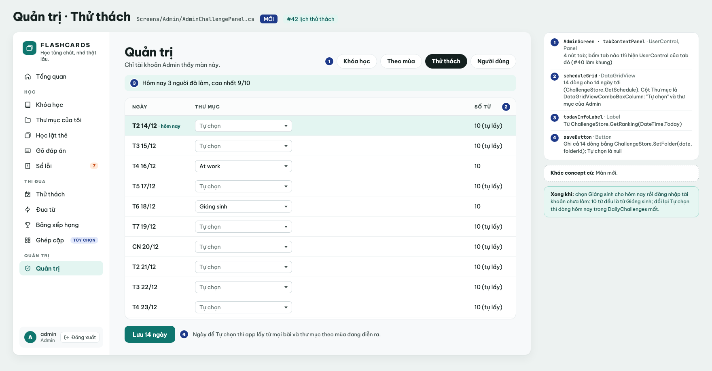

| Tên | Loại | Làm gì |
|---|---|---|
| `todayInfoLabel` | Label | "Hôm nay 3 người đã làm, cao nhất 9/10" (từ `ChallengeStore.GetRanking(DateTime.Today)`) |
| `scheduleGrid` | DataGridView | 14 dòng cho 14 ngày tới (`ChallengeStore.GetSchedule`). Cột Thư mục là DataGridViewComboBoxColumn: "Tự chọn" và các thư mục của Admin. Dòng hôm nay nền `#E3F5F1` |
| `saveButton` | Button | "Lưu 14 ngày": mỗi dòng gọi `ChallengeStore.SetFolder(date, folderId)`; "Tự chọn" thì `folderId` là `null` |

Ngày để "Tự chọn" thì app lấy từ mọi bài và thư mục theo mùa đang diễn ra.

**Xong khi:** chọn Giáng sinh cho hôm nay rồi đăng nhập tài khoản chưa làm thì 10 từ đều là từ Giáng sinh; đổi lại Tự chọn thì dòng hôm nay trong bảng `DailyChallenges` mất.

### 12d. Tab Người dùng · `AdminUserPanel` (#44)

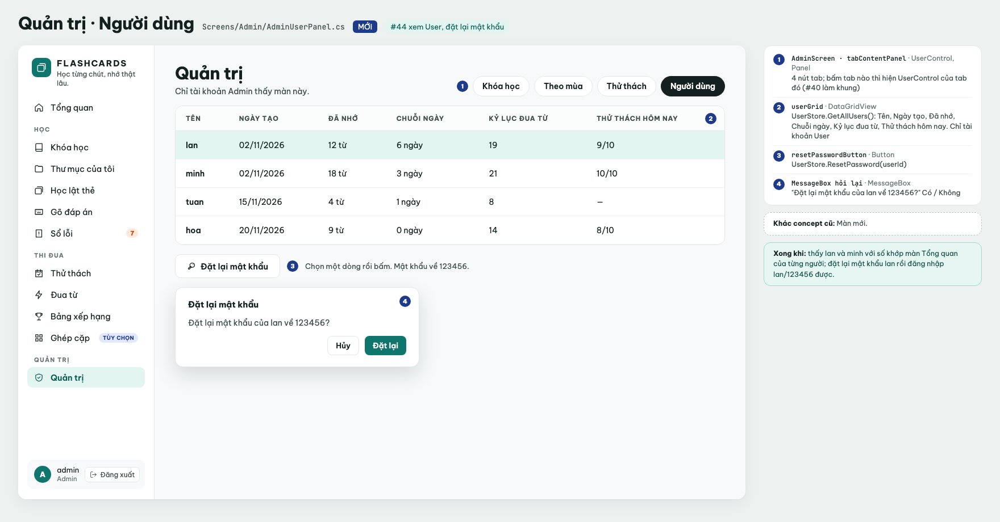

| Tên | Loại | Làm gì |
|---|---|---|
| `userGrid` | DataGridView | `UserStore.GetAllUsers()`: Tên, Ngày tạo, Đã nhớ, Chuỗi ngày, Kỷ lục đua từ, Thử thách hôm nay. Chỉ tài khoản User |
| `resetPasswordButton` | Button | Chọn một dòng rồi bấm: hỏi lại bằng MessageBox (đã viết sẵn) "Đặt lại mật khẩu của lan về 123456?", Có thì gọi `UserStore.ResetPassword` |

**Xong khi:** thấy lan và minh với số khớp màn Tổng quan của từng người; đặt lại mật khẩu lan rồi đăng nhập lan/123456 được.
