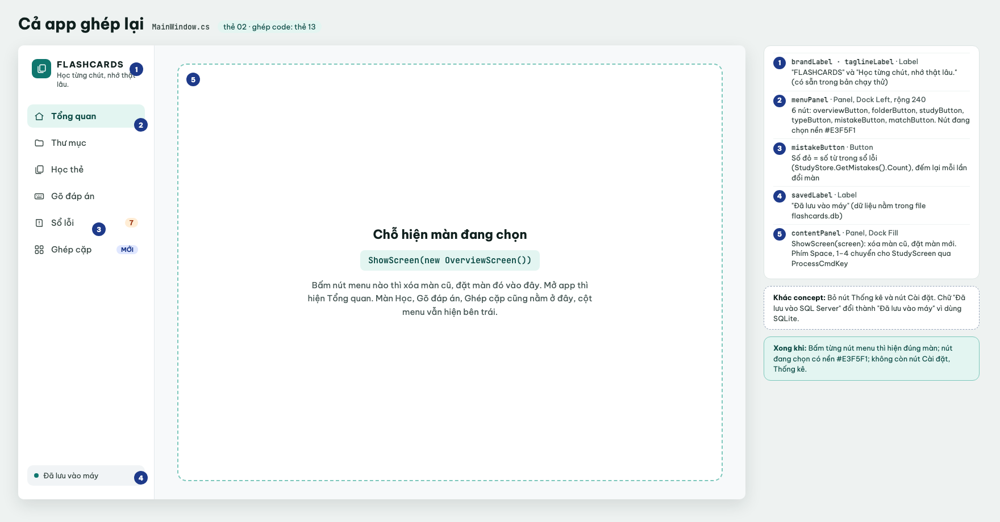
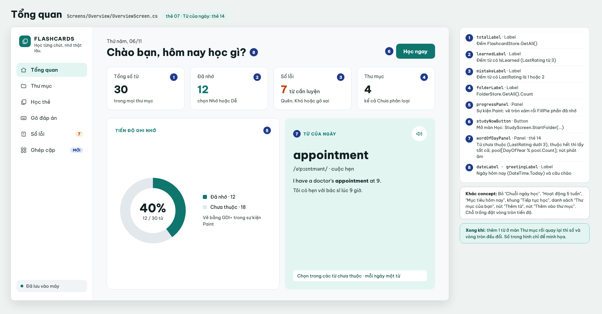
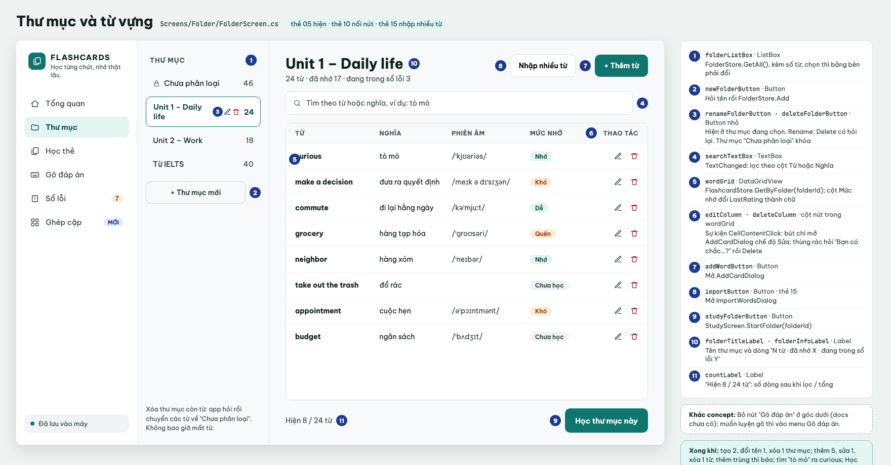
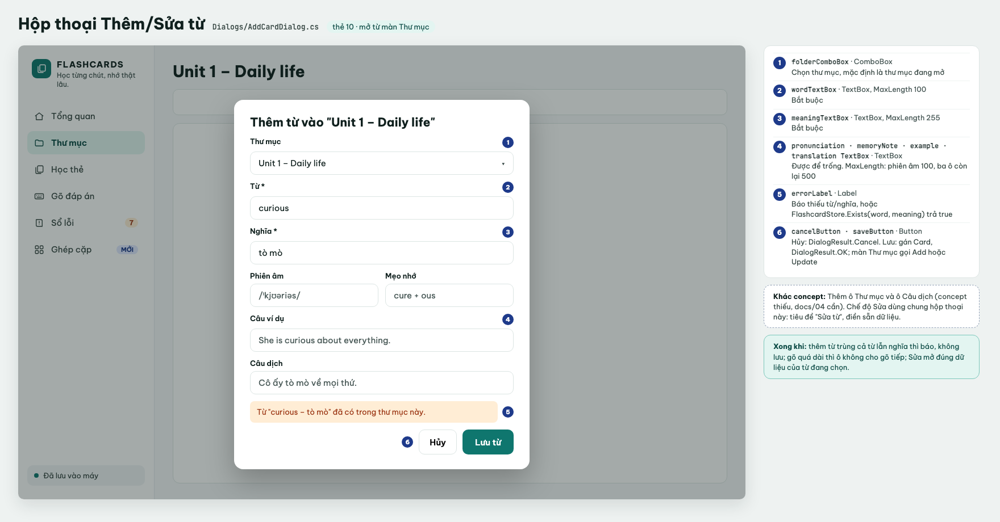
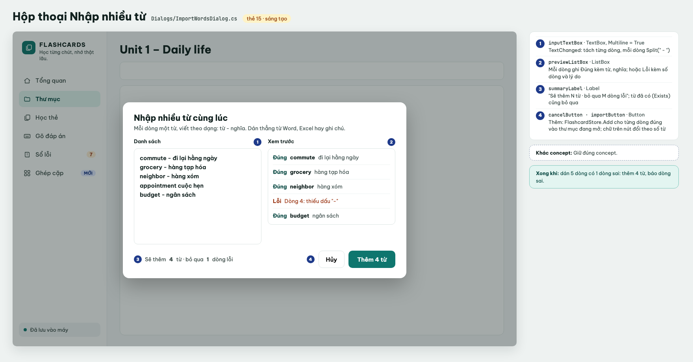
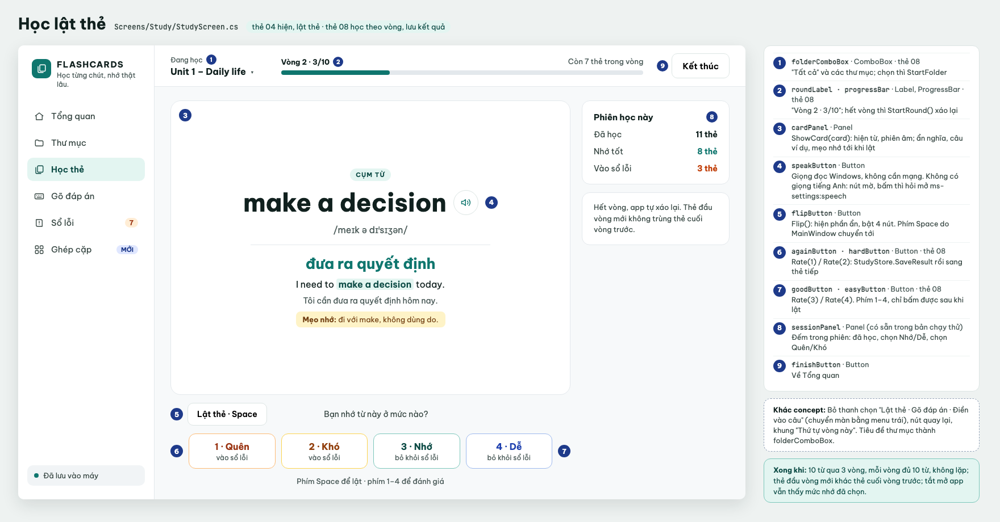
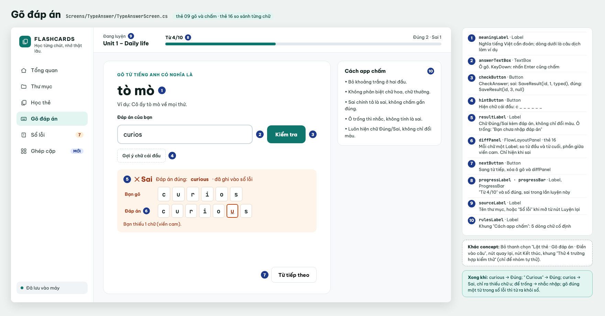
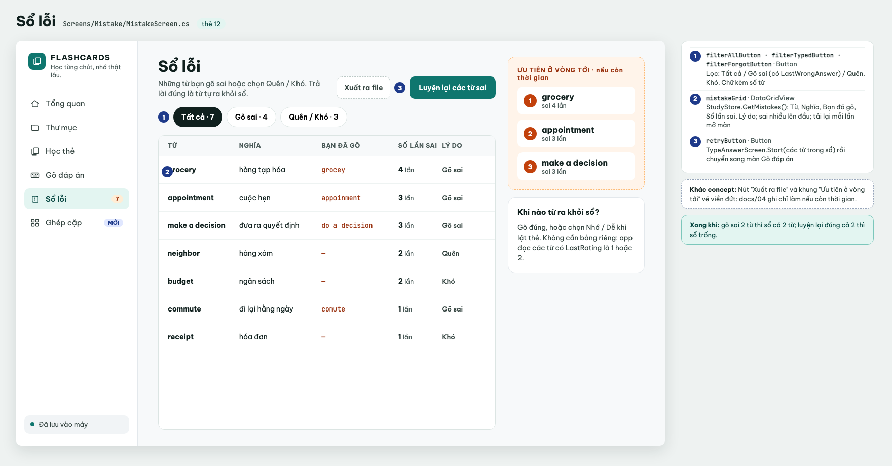
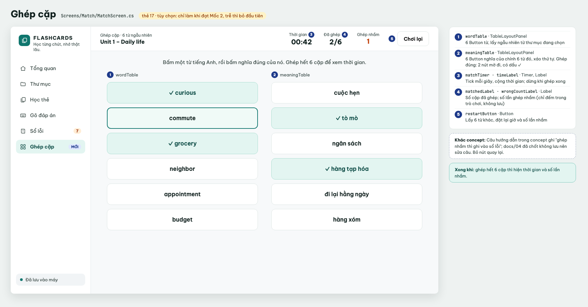

# Concept GUI (có thể thay đổi trong quá trình làm)

Màu dùng chung: xanh chính `#0F766E`, nền chọn `#E3F5F1`, cam báo lỗi `#C2410C`, nền màn `#F7F9FA`, thẻ trắng bo góc..

---

## 0. Cửa sổ chính · `MainWindow`

Khung bao quanh mọi màn: cột menu bên trái rộng 240, phần còn lại hiện màn hình con đang chọn.

| Tên | Loại | Làm gì |
|---|---|---|
| `brandLabel`, `taglineLabel` | Label | "FLASHCARDS" và "Học từng chút, nhớ thật lâu." (có sẵn trong bản chạy thử) |
| `menuPanel` | Panel, Dock Left, rộng 240 | Chứa các nút menu |
| `overviewButton`, `folderButton`, `studyButton`, `typeButton`, `mistakeButton`, `matchButton` | Button | Bấm thì gọi `ShowScreen` với màn tương ứng. Nút đang chọn nền `#E3F5F1`, chữ đậm |
| `mistakeButton` | Button | Bên phải có số đỏ = số từ trong sổ lỗi (`StudyStore.GetMistakes().Count`), đếm lại mỗi lần đổi màn |
| `matchButton` | Button | Bên phải có nhãn "MỚI" |
| `savedLabel` | Label | Cuối cột menu: "Đã lưu vào máy" |
| `contentPanel` | Panel, Dock Fill | Chỗ hiện màn hình con |

**So với bản chạy thử:** bỏ nút **Cài đặt** (cùng hộp thoại Cài đặt) và nút **Thống kê**; phím tắt luôn bật. Phím tắt giữ trong hàm `ProcessCmdKey` có sẵn của `MainWindow`: khi đang ở màn Học thì chuyển phím cho `StudyScreen`. Phần giao diện đang nằm chung trong `MainWindow.Designer.cs` chuyển sang màn hình con tương ứng. `MainWindow_Load` tạm giữ cách đọc file JSON; khi thẻ #3 xong (app đã có file SQLite `flashcards.db`) thì đổi sang `FlashcardStore.GetAll()` và bỏ `TrySave`.

**Xong khi:** bấm từng nút menu thì hiện đúng màn, nút đang chọn có nền `#E3F5F1`; số ở nút Sổ lỗi đúng; không còn nút Cài đặt, Thống kê.

## 1. Tổng quan · `OverviewScreen`

Trên cùng: ngày hôm nay và câu chào "Chào bạn, hôm nay học gì?", bên phải là nút Học ngay. Dưới là 4 thẻ số, rồi 2 khung lớn: tiến độ ghi nhớ (trái) và Từ của ngày (phải, nền xanh nhạt).

| Tên | Loại | Làm gì |
|---|---|---|
| `dateLabel`, `greetingLabel` | Label | Ngày hôm nay (`DateTime.Today`) và câu chào |
| `studyNowButton` | Button | "Học ngay": mở màn Học (`StudyScreen.StartFolder`) |
| `totalLabel`, `learnedLabel`, `mistakeLabel`, `folderLabel` | Label | 4 thẻ số: tổng số từ, đã nhớ (`IsLearned`), trong sổ lỗi (`LastRating` 1 hoặc 2), số thư mục |
| `progressPanel` | Panel | "Tiến độ ghi nhớ": vòng tròn đã nhớ / tổng số từ vẽ bằng GDI+ trong sự kiện `Paint` (`Graphics.FillPie`), bên cạnh ghi số đã nhớ, chưa thuộc |
| `wordOfDayPanel` | Panel | **Sáng tạo #14:** Từ của ngày: từ, phiên âm · nghĩa, câu ví dụ, câu dịch, nút phát âm ở góc. Chọn trong các từ chưa thuộc (`LastRating` dưới 3), thuộc hết thì chọn trong tất cả; chưa có từ nào thì ẩn |

Mỗi lần mở màn này thì đếm lại số. Đọc file SQLite rất nhanh nên không cần chạy nền.
**Không làm** (có trong ảnh concept cũ): Mục tiêu hôm nay, Chuỗi ngày học, Hoạt động 5 tuần, khung Tiếp tục học, danh sách Thư mục của bạn, nút Thêm từ, nút Thêm vào thư mục.

**Xong khi:** số liệu đọc từ file dữ liệu SQLite, thêm 1 từ rồi quay lại thì số và vòng tròn đều đổi.

## 2. Thư mục và từ vựng · `FolderScreen`

Ba cột: menu chung, cột thư mục (rộng 260), bảng từ. Trên bảng là tên thư mục, dòng "24 từ · đã nhớ 17 · đang trong sổ lỗi 3", nút Nhập nhiều từ và Thêm từ, ô tìm. Dưới bảng là "Hiện 8 / 24 từ" và nút Học thư mục này.

| Tên | Loại | Làm gì |
|---|---|---|
| `folderListBox` | ListBox | Danh sách thư mục kèm số từ; chọn thì bảng bên phải đổi. "Chưa phân loại" có biểu tượng khóa |
| `newFolderButton` | Button | "+ Thư mục mới" dưới danh sách: hỏi tên rồi `FolderStore.Add` |
| `renameFolderButton`, `deleteFolderButton` | Button nhỏ | Bút chì và thùng rác hiện ở thư mục đang chọn. Đổi tên; xóa có hỏi lại. Thư mục số 1 không có hai nút này |
| `folderTitleLabel`, `folderInfoLabel` | Label | Tên thư mục và dòng "N từ · đã nhớ X · đang trong sổ lỗi Y" |
| `importButton` | Button | **Sáng tạo #15:** "Nhập nhiều từ", mở hộp thoại Nhập nhiều từ |
| `addWordButton` | Button | "+ Thêm từ", mở hộp thoại Thêm từ |
| `searchTextBox` | TextBox | Gõ tới đâu lọc tới đó theo cột Từ hoặc Nghĩa (sự kiện TextChanged) |
| `wordGrid` | DataGridView | Cột: Từ, Nghĩa, Phiên âm, Mức nhớ (chữ Chưa học / Quên / Khó / Nhớ / Dễ), Thao tác |
| `editColumn`, `deleteColumn` | Cột nút trong `wordGrid` (DataGridViewButtonColumn) | Cột Thao tác: bút chì mở hộp thoại ở chế độ Sửa, thùng rác hỏi "Bạn có chắc muốn xóa từ này?" rồi xóa. Bắt bằng sự kiện `CellContentClick` |
| `countLabel` | Label | "Hiện 8 / 24 từ" (số dòng sau khi lọc / tổng) |
| `studyFolderButton` | Button | "Học thư mục này": `StudyScreen.StartFolder(folderId)` |

Dưới cột thư mục ghi: *"Xóa thư mục còn từ: app hỏi rồi chuyển các từ về "Chưa phân loại". Không bao giờ mất từ."*
**Không làm:** nút "Gõ đáp án" ở góc dưới (muốn luyện gõ thì vào menu Gõ đáp án).

**Hộp thoại Thêm/Sửa từ** (`Dialogs/AddCardDialog`, đã có trong bản chạy thử). Tiêu đề "Thêm từ vào "<tên thư mục>"", chế độ Sửa thì "Sửa từ" và điền sẵn dữ liệu.

| Tên | Loại | Làm gì |
|---|---|---|
| `folderComboBox` | ComboBox | Chọn thư mục, mặc định là thư mục đang mở |
| `wordTextBox`, `meaningTextBox` | TextBox | Bắt buộc. `MaxLength` 100 và 255 |
| `pronunciationTextBox`, `memoryNoteTextBox` | TextBox | Hai ô cạnh nhau: Phiên âm (`MaxLength` 100), Mẹo nhớ (500) |
| `exampleTextBox`, `translationTextBox` | TextBox | Câu ví dụ, Câu dịch (`MaxLength` 500) |
| `errorLabel` | Label | Nền cam nhạt: thiếu từ/nghĩa, hoặc `FlashcardStore.Exists(word, meaning)` trả true: *"Từ "curious – tò mò" đã có trong thư mục này."* |
| `cancelButton`, `saveButton` | Button | Hủy (`DialogResult.Cancel`), Lưu từ (gán `Card`, `DialogResult.OK`; màn Thư mục gọi `Add` hoặc `Update`) |

Bản chạy thử đặt tên ô là `word`, `meaning`…: đổi sang tên trên. `MaxLength` bản chạy thử đang cho 300 và 1000, lưu sẽ lỗi.

**Hộp thoại Nhập nhiều từ** (`Dialogs/ImportWordsDialog`, sáng tạo #15). Tiêu đề "Nhập nhiều từ cùng lúc", dòng hướng dẫn "Mỗi dòng một từ, viết theo dạng: từ - nghĩa".

| Tên | Loại | Làm gì |
|---|---|---|
| `inputTextBox` | TextBox, Multiline | "Danh sách": dán nhiều dòng; TextChanged thì tách từng dòng bằng `Split(" - ")` |
| `previewListBox` | ListBox | "Xem trước": mỗi dòng ghi **Đúng** kèm từ, nghĩa; hoặc **Lỗi** kèm số dòng và lý do |
| `summaryLabel` | Label | "Sẽ thêm N từ · bỏ qua M dòng lỗi"; từ đã có cũng bỏ qua |
| `cancelButton`, `importButton` | Button | Hủy; "Thêm N từ": `FlashcardStore.Add` từng dòng đúng vào thư mục đang mở |

**Xong khi:** tạo 2 thư mục, đổi tên 1, xóa 1 (từ trong đó về "Chưa phân loại"); thêm 5 từ, sửa 1, xóa 1; thêm trùng thì báo; tìm "tò mò" ra curious; bấm Học thư mục này thì vào đúng thư mục.

## 3. Học lật thẻ · `StudyScreen`

Thanh trên cùng (nền trắng, cao 72): thư mục đang học, tiến độ vòng, nút Kết thúc. Giữa là thẻ lớn, dưới thẻ là nút lật và 4 nút đánh giá. Cột phải rộng 260: "Phiên học này".

| Tên | Loại | Làm gì |
|---|---|---|
| `folderComboBox` | ComboBox | Dưới chữ "Đang học": chọn thư mục hoặc "Tất cả" |
| `roundLabel`, `progressBar` | Label, ProgressBar | "Vòng 2 · 3/10", bên phải "Còn 7 thẻ trong vòng" |
| `finishButton` | Button | "Kết thúc": về Tổng quan |
| `cardPanel` | Panel | Nhãn TỪ VỰNG / CỤM TỪ, từ, phiên âm; dưới gạch là nghĩa, câu ví dụ (từ được tô nền xanh), câu dịch, mẹo nhớ. Phần dưới gạch ẩn tới khi lật |
| `speakButton` | Button tròn cạnh từ | Đọc từ bằng giọng của Windows (đã có trong bản chạy thử), không cần mạng. Máy không có giọng tiếng Anh thì nút mờ, ToolTip "Máy chưa có giọng đọc tiếng Anh"; bấm vào thì hỏi mở cài đặt giọng đọc (`ms-settings:speech`) |
| `flipButton` | Button | "Lật thẻ · Space" |
| `againButton`, `hardButton`, `goodButton`, `easyButton` | Button | "1 · Quên", "2 · Khó" (dòng dưới: vào sổ lỗi), "3 · Nhớ", "4 · Dễ" (bỏ khỏi sổ lỗi). Phím **1–4**. Chỉ bấm được sau khi lật. Bấm thì gọi `StudyStore.SaveResult` rồi sang thẻ tiếp |
| `sessionPanel` | Panel (có sẵn trong bản chạy thử) | "Phiên học này": Đã học, Nhớ tốt (chọn Nhớ/Dễ), Vào sổ lỗi (chọn Quên/Khó) |

Dưới các nút ghi "Phím Space để lật · phím 1–4 để đánh giá". Dưới `sessionPanel` ghi "Hết vòng, app tự xáo lại. Thẻ đầu vòng mới không trùng thẻ cuối vòng trước."
Phím tắt: dùng lại hàm `ProcessCmdKey` có sẵn trong `MainWindow` (Space, 1–4), `MainWindow` chuyển phím cho màn này. Code vẽ và lật thẻ (`RenderCard`, `FitWordLabel`) cũng lấy từ `MainWindow`.
**So với bản chạy thử:** bỏ nút trước/sau (phím ←/→) và chữ hẹn giờ "1 phút / 10 phút / 1 ngày / 4 ngày" trên 4 nút, vì app học theo vòng, không hẹn lịch ôn.
Thư mục trống: báo *"Thư mục này chưa có từ. Hãy thêm từ trước."*
**Không làm:** thanh chọn "Lật thẻ · Gõ đáp án · Điền vào câu" (chuyển màn bằng menu trái), nút quay lại, khung "Thứ tự vòng này".

**Xong khi:** học thư mục 10 từ qua 3 vòng, mỗi vòng đủ 10 từ, không lặp; thẻ đầu vòng mới khác thẻ cuối vòng trước; tắt mở app vẫn thấy kết quả đã chọn.

## 4. Gõ đáp án · `TypeAnswerScreen`

Thanh trên cùng: "Đang luyện" + tên thư mục, tiến độ. Giữa là thẻ lớn để gõ. Cột phải rộng 260: "Cách app chấm".

| Tên | Loại | Làm gì |
|---|---|---|
| `sourceLabel` | Label | "Đang luyện" + tên thư mục, hoặc "Sổ lỗi" khi mở từ nút Luyện lại |
| `progressLabel`, `progressBar` | Label, ProgressBar | "Từ 4/10", bên phải "Đúng 2 · Sai 1" |
| `meaningLabel` | Label | Dưới chữ "GÕ TỪ TIẾNG ANH CÓ NGHĨA LÀ": nghĩa tiếng Việt cần đoán, dòng dưới là câu dịch làm ví dụ |
| `answerTextBox` | TextBox | "Đáp án của bạn". Nhấn **Enter** cũng chấm (sự kiện KeyDown) |
| `checkButton` | Button | "Kiểm tra": chấm đáp án |
| `hintButton` | Button viền đứt | "Gợi ý chữ cái đầu": hiện `c _ _ _ _ _ _` |
| `resultLabel` | Label | Trong khung cam nhạt: **✕ Sai** · "Đáp án đúng: curious · đã ghi vào sổ lỗi"; đúng thì **Đúng** nền xanh. Không chỉ đổi màu |
| `diffPanel` | FlowLayoutPanel | **Sáng tạo #16:** hai hàng ô chữ "Bạn gõ" và "Đáp án"; chữ sai viền cam, dòng dưới "Bạn thiếu 1 chữ (viền cam)." |
| `nextButton` | Button | "Từ tiếp theo" |
| `rulesLabel` | Label | Khung "Cách app chấm": 5 dòng quy tắc chấm (chữ cố định) |

Cách chấm: bỏ khoảng trắng hai đầu, không phân biệt hoa thường. Ô trống: *"Bạn chưa nhập đáp án"*, không tính sai. Sai chính tả là sai.
Sau khi chấm: gõ sai gọi `StudyStore.SaveResult` mức 1 kèm chữ vừa gõ; gõ đúng gọi mức 3 để từ ra khỏi sổ lỗi.
**Không làm:** thanh chọn "Lật thẻ · Gõ đáp án · Điền vào câu", nút quay lại, nút Kết thúc, khung "Thử 4 trường hợp kiểm thử" (chỉ để nhóm tự thử).

**Xong khi:** gõ `curious` → Đúng; ` Curious` → Đúng; `curios` → Sai, chỉ ra thiếu chữ u; để trống → nhắc nhập; gõ đúng một từ trong sổ lỗi thì từ đó ra khỏi sổ.

## 5. Sổ lỗi · `MistakeScreen`

Trên cùng: tiêu đề "Sổ lỗi", dòng "Những từ bạn gõ sai hoặc chọn Quên / Khó. Trả lời đúng là từ tự ra khỏi sổ.", nút Luyện lại. Dưới là các nút lọc dạng viên thuốc và bảng. Cột phải rộng 270.

| Tên | Loại | Làm gì |
|---|---|---|
| `filterAllButton`, `filterTypedButton`, `filterForgotButton` | Button | "Tất cả · 7", "Gõ sai · 4" (có `LastWrongAnswer`), "Quên / Khó · 3". Nút đang chọn nền đậm |
| `mistakeGrid` | DataGridView | Từ, Nghĩa, Bạn đã gõ (chữ cam, "—" nếu không gõ), Số lần sai, Lý do. Sắp theo số lần sai giảm dần |
| `retryButton` | Button | "Luyện lại các từ sai": `TypeAnswerScreen.Start(các từ trong sổ)` rồi chuyển sang màn Gõ đáp án |

Cột phải có khung "Khi nào từ ra khỏi sổ?": gõ đúng, hoặc chọn Nhớ / Dễ khi lật thẻ.
**Nếu còn thời gian:** nút "Xuất ra file" và khung "Ưu tiên ở vòng tới" (3 từ sai nhiều nhất).

**Xong khi:** gõ sai 2 từ thì sổ có 2 từ; luyện lại đúng cả 2 thì sổ trống.

## 6. Ghép cặp · `MatchScreen` (tùy chọn)

Chỉ làm nếu đạt Mốc 2 (18/11). Thanh trên cùng: "Ghép cặp · 6 từ ngẫu nhiên" + tên thư mục, thời gian, đã ghép, ghép nhầm, nút Chơi lại. Dưới là câu hướng dẫn và 2 cột nút.

| Tên | Loại | Làm gì |
|---|---|---|
| `wordTable`, `meaningTable` | TableLayoutPanel | 6 nút từ bên trái, 6 nút nghĩa bên phải (xáo). Đang chọn: viền xanh đậm; ghép đúng: nền xanh nhạt, dấu ✓, không bấm được nữa |
| `matchTimer`, `timeLabel` | Timer, Label | "Thời gian 00:42", tăng mỗi giây, dừng khi ghép xong |
| `matchedLabel`, `wrongCountLabel` | Label | "Đã ghép 2/6", "Ghép nhầm 1" (chỉ đếm trong trò chơi, không lưu vào file dữ liệu) |
| `restartButton` | Button | "Chơi lại": lấy 6 từ khác, đặt lại giờ và số lần nhầm |

Câu hướng dẫn: *"Bấm một từ tiếng Anh, rồi bấm nghĩa đúng của nó. Ghép hết 6 cặp để xem thời gian."*

**Xong khi:** ghép hết 6 cặp thì hiện thời gian và số lần nhầm.
